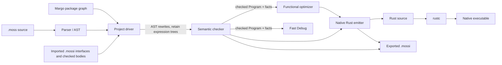

# Moss compiler architecture

This document describes the implementation at the current repository revision. The [compiler contract](MOSS_COMPILER_CONTRACT.md) owns the numbered invariants and their current status; this guide explains how the stages and data fit together.

## The path through the compiler

The driver resolves project inputs and arranges the stages. It does not own Moss language meaning. The checker is the producer of static answers. Fast Debug executes the checked program, the optimizer applies checked functional plans, and the emitter lowers checked decisions to Rust. `rustc` checks and builds the emitted Rust; it does not decide Moss semantics.

| Stage | Purpose; input → output | Main data and implementation | Owns / must not decide |
| --- | --- | --- | --- |
| Parse | Read each source file → declarations and statement AST. | `src/parser.cpp` `parse_source`; `src/parser.hpp` `parse_source`; AST types in `src/ast.hpp`. | Owns Moss syntax recognition and source locations. It does not resolve types or call targets. |
| Project driver and rewrites | Resolve project and imported modules, perform the current AST/name/text rewrites, then prepare checked units → source-ordered `Program`s. | `src/moss.cpp` `check_project_sources`, `analyze_project_sources`, `rebuild_expression_slot`, `rebuild_changed_slots`; `margo` `resolve_graph`, `build_graph`. | Owns orchestration, package graph and rewrite mechanics. It must not decide expression types, overloads, or other language semantics. Some rewrites still change expression text and rebuild trees. |
| Expression-tree retention | Turn retained expression slots into navigable nodes and associate source slots with IDs → handles reachable from `Program`. | `src/est/expression_tree.hpp` `Arena`, `ExprId`, `Handle`, `populate`; `src/est/expression_tree.cpp` `populate`, `populate_impl`, `rebuild_slot`; `Program::expression_arenas`, statement and function `expression_handles` in `src/ast.hpp`. | Owns syntax-tree storage and occurrence identity only. It does not infer Moss meaning. |
| Checker | Analyze declarations, expressions, calls, control flow, effects, and pipelines → checked `Program` plus facts and plans. | `src/semantic_checker.hpp` `CheckedProgram`, `check_program`; `src/semantic_checker.cpp` `Checker`, `CheckedProgram::run`, `check_program`. | Sole owner of static Moss decisions. Missing facts at a consumer boundary are errors or the explicitly documented debt in the contract. |
| Fact and plan handoff | Keep per-node, per-context answers and structured call, flow and pipeline decisions attached to the checked compilation. | `src/est/expression_tree.hpp` `SemanticFacts`, `FactKey`, `Arena::record_facts`; `src/ast.hpp` `SemanticCallEdge`, `FunctionSpecialization`, `Stmt::FunctionalExpressionPlan`; `src/functional_ir.hpp` `FunctionalPipeline`. | Carries checker answers; it is not a second authority. Consumers may select the applicable keyed fact, not recompute it. |
| Functional optimizer | Apply permitted functional-pipeline rewrites → optimized checked program and pipeline annotations. | `src/functional_optimizer.cpp` `FunctionalOptimizer`, `optimize_program`; `src/functional_ir.hpp` `FunctionalPipeline`. | May decide whether and how to apply a semantics-preserving optimization using recorded plans/proofs. It must not invent Moss types, targets, or proofs. |
| Fast Debug | Execute a checked program deterministically → output, exit/failure result, optional trace. | `src/interpreter.hpp` `FastInterpreter`; `src/moss.cpp` `run_fast_interpreter_source`, `load_checked_interpreter_program`. | Owns execution of checked operations. It must not select an overload, infer a Moss type, or reinterpret a pattern when the checker has recorded the answer. |
| Native emitter | Lower checked and optionally optimized program → Rust source and module interfaces. | `src/native_generator.cpp` `Generator`, `generate_native`, `call_specialization`, `generated_expr_type`; `src/moss.cpp` `compile_native_artifact`, `write_module_interfaces`. | Owns Rust syntax, ABI representation, and mechanical lowering. It must not decide Moss expression types, call targets, specializations, joins, or patterns. Lowering-only Rust representations are listed in the Phase 27.5.5 report. |
| Rust build | Compile emitted Rust → native artifact. | `src/moss.cpp` `compile_native_artifact`; external `rustc` invocation. | Owns Rust validity and machine-code generation, not Moss static semantics. |
| Package and `.mossi` boundary | Build dependencies in dependency order; serialize exports and checked imported bodies → package artifacts and provider records. | `margo` `resolve_graph`, `build_graph`; `src/moss.cpp` `write_module_interfaces`, `append_execution_body_section`, `load_module_interface`, `parse_execution_body_payload`; `src/ast.hpp` `LoadedExpressionFact`. | Margo owns manifest and dependency resolution. Moss owns module semantics and interface validation. A loaded interface supplies facts; it does not authorize consumers to infer missing facts. |

Standalone commands enter through Moss directly. Package commands use Margo to resolve dependencies and invoke Moss for source checking/building. A checked project can feed Fast Debug or optimization and emission. Native builds serialize module interfaces for downstream package builds; imported `.mossi` data is loaded before checking dependent sources.

## Data carried between stages

| Data | Built by; readers | Lifetime and key |
| --- | --- | --- |
| AST (`Program`, declarations, `Stmt`) | `Parser::parse`/`parse_source` builds it; checker, driver, Fast Debug, optimizer and emitter read it. | One compilation/project analysis. Statements retain source-oriented strings and locations. `Program` owns arenas, declarations, call edges and specialization records. |
| Expression tree (`Arena`, `ExprId`, `Handle`) | Expression-tree builders and driver rewrites create nodes; checker and consumers navigate them. | Arena lifetime is the owning `Program`. `ExprId` is an arena-local numeric node ID; a `Handle` identifies an owner, expression slot, argument occurrence and arena. IDs remain stable as the vector grows; references from `Arena::at` do not, so retain IDs across appends and reacquire references. |
| `SemanticFacts` | `Checker` records facts through `Arena::record_facts`; Fast Debug, emitter, optimizer and interface serialization read them. | Stored beside syntax in each arena, keyed by `FactKey { ExprId, specialization_context }`. Fields include checked type, resolved target, specialization result, and inferred effect. |
| Types | Checker records expression and pipeline types; consumers request checked facts. `TypeRef` is the internal typed representation; `.mossi` serializes stable type names/records. | Expression type is keyed by node and specialization context. Pipeline source/stage/output types are on the functional plan/node records and context-scoped statement plan associations. Rust ABI forms are emitter details, not alternate Moss types. |
| Call targets and call edges | Checker resolves calls and records `SemanticCallEdge`; Fast Debug and emitter select the matching edge. | `Program::semantic_call_edges` entries identify source context, target, line/occurrence, argument types, invocation kind, receiver, and specialization identity. Call facts are associated with the expression occurrence and context where available. |
| Specializations | Checker creates `FunctionSpecialization` entries and call-edge specialization keys; emitter and Fast Debug read them. | Lives with the function declaration in the checked `Program`; keyed by its concrete parameter types/context and specialization key. Generic unspecialized calls remain valid when no specialization is required. |
| Joins and patterns | Checker records `Stmt::joined_types_by_context`, `Stmt::joined_types`, `Stmt::est_pattern`, and failure-arm `est_patterns`; Fast Debug and emitter consume them. | Lifetime is the checked AST. Joins are context-keyed (with the common joined type projection); patterns carry resolved enum/variant and binding structure, not just source spelling. |
| Functional pipeline plans | Checker builds per-context `Stmt::FunctionalExpressionPlan` associations and `FunctionalPipeline` records; optimizer, Fast Debug, and emitter consume them. | Plan associations live on statements/functions and are keyed by functional context and expression handle. A pipeline has a compilation-local ID and semantic identity/provenance; its nodes carry input/output types, callable identity, effects, and optimizer eligibility. |
| `.mossi` | `write_module_interfaces` emits exported declarations and checked provider data; `load_module_interface` validates and loads it. | Durable package artifact. It contains module/interface metadata and, where needed, generic IR and a checked executable-body section with expression facts. Imported records are attached to the dependent compilation's `Program`; arena IDs are remapped into its arenas and are not cross-build identities. |

The AST's expression strings remain useful source data, diagnostic text, and rewrite input. The current driver still has text-to-tree rewrites. Consumer traversal is by retained handles and IDs; consumers should not use string equality as node identity. `Arena` uses vector storage: the node IDs survive growth, but `Node&` references do not.

## Static decision boundaries

The checker decides type and overload selection, member/method targets, generic specialization, pipeline typing and eligibility facts, flow joins, pattern resolution, effects/ownership, and lock requirements. Those answers live in the structures above. In the emitter, `generated_expr_type` is a checked-fact access point; Rust borrow forms, result wrappers, runtime container types, and syntax are lowering choices. Fast Debug chooses a runtime operation only after reading the checker-selected target/operator. The optimizer may conservatively skip an optimization when its checked proof is unavailable.

Do not “help” a consumer by recomputing a missing type from operand/runtime values, resolving a member from receiver type, selecting a specialization from consumer-derived argument types, joining branch environments, or parsing a pattern spelling. Extend the checker’s recorded answer and its typed accessor instead. The known ownership fact-hook gaps are linked below; do not enlarge them without updating the contract and required tests.

## Gaps, by stage

These are the current shortfalls. Each link names the matching entry in the contract’s [Declared debt](MOSS_COMPILER_CONTRACT.md#declared-debt). The contract retains the measurements; this guide does not repeat them.

<!-- architecture-gaps:start -->
| Stage | Contract invariant | What happens and why it remains | Owner and contract entry |
| --- | --- | --- | --- |
| Driver | 2 | Some post-parse rewrites still edit expression text and rebuild retained trees. The rewrite passes predate the tree representation and only refresh handles after changing their text. | Unscheduled — [D-DRIVER-TREE](MOSS_COMPILER_CONTRACT.md#d-driver-tree). |
| Checker | 1, 3 | Recursive checking still reparses expression fragments and consults text-keyed caches. The consumer-scoped migration retained these internal passes; no later checker-tree conversion phase is assigned. Lock-requirement perturb/drop coverage is also still pending because that decision class has not been added to the fact-hook matrix. | Unscheduled — [D-CHECKER-TEXT](MOSS_COMPILER_CONTRACT.md#d-checker-text), [D-LOCK-TEST](MOSS_COMPILER_CONTRACT.md#d-lock-test). |
| Fast Debug | 4, 6 | Some ownership perturbations still leave runtime copy/move/borrow behavior unchanged. The recorded test-build debt remains because Phase 27 migrated other fact classes first. | Planned, Phase 28 — [D-OWNERSHIP-FACTS](MOSS_COMPILER_CONTRACT.md#d-ownership-facts). |
| Native emitter | 4, 7, 9 | Some ownership perturbations still leave lowering unchanged; the nested-mutation baseline source also reaches Rust that rustc rejects. | Planned, Phase 28 for ownership — [D-OWNERSHIP-FACTS](MOSS_COMPILER_CONTRACT.md#d-ownership-facts); unscheduled for the baseline source — [D-BASELINE-SUITE](MOSS_COMPILER_CONTRACT.md#d-baseline-suite), [D-ACCEPTED-RUST](MOSS_COMPILER_CONTRACT.md#d-accepted-rust). |
| Optimizer | 4, 6 | Some ownership perturbations still leave optimized execution unchanged. The checked type and pipeline paths are migrated, while this ownership gap remains recorded debt. | Planned, Phase 28 — [D-OWNERSHIP-FACTS](MOSS_COMPILER_CONTRACT.md#d-ownership-facts). |
| `.mossi` | 4, 6 | Imported provider paths do not yet propagate and consume all ownership-related facts. | Planned, Phase 28 — [D-OWNERSHIP-FACTS](MOSS_COMPILER_CONTRACT.md#d-ownership-facts). |
| Packages | 4, 7, 9 | Package builds exercise the incomplete imported ownership path; one conformance job also has a Cargo jobserver failure. | Planned, Phase 28 for ownership — [D-OWNERSHIP-FACTS](MOSS_COMPILER_CONTRACT.md#d-ownership-facts); unscheduled for the suite failure — [D-BASELINE-SUITE](MOSS_COMPILER_CONTRACT.md#d-baseline-suite). |
| Cross-engine validation | 7 | Trace-event parity is not compared, and a seeded program generator is not registered. | Unscheduled — [D-TRACE-PARITY](MOSS_COMPILER_CONTRACT.md#d-trace-parity); planned, after Phase 28 — [D-PROGRAM-GENERATOR](MOSS_COMPILER_CONTRACT.md#d-program-generator). |
| Native compilation gate | 9 | Checker-accepted programs can still produce Rust rejected by rustc; the ratcheting allowlist and current failures document the cases. | Unscheduled — [D-ACCEPTED-RUST](MOSS_COMPILER_CONTRACT.md#d-accepted-rust). |
<!-- architecture-gaps:end -->

## Phase map

### Phase 27 — closed at `phase27-5-5-m1`

Phase 27 added retained expression nodes and checked fact/plan handoffs for the migrated decisions. Fast Debug, the emitter, and optimizer navigate those trees and read checker answers; perturb/drop tests and the runtime counter ratchet are registered. The residual work is listed above rather than treated as completed.

### Planned, Phase 28 — ownership debt

Phase 28 owns the ownership and parameter-effect debt listed in the contract. This guide does not specify ownership decisions or language rules for that phase.

### Other recorded work

- The checker/driver tree-first rewrite was planned in Phase 27’s lazy expression-tree design. Phase 27 is closed; the remaining checker string passes and driver text rewrites are currently **unscheduled**.
- **Planned, after Phase 28:** the seeded program generator is recorded validation work.
- **Planned, Phase 28:** the Graph DSL is recorded as a tree-first consumer after S3.

## Contract gates in this architecture

The numbered invariant definitions stay in the [contract](MOSS_COMPILER_CONTRACT.md); this table maps them to the code boundary and the gate that tests that boundary.

| Contract invariant | Architectural meaning here | Gate and command |
| --- | --- | --- |
| 1 | After initial source or imported-body loading, downstream stages do not parse expression strings. Checker-internal string passes remain measured debt under the current scope. | `make check` and `make check-shadow`; `check_phase27_string_debt.py` and `check_phase27_5_4_runtime_ratchet.py`. |
| 2 | Post-parse changes should preserve/update tree nodes rather than rebuild from rewritten expression text; current driver count is debt. | `make check` and `make check-shadow`; runtime ratchet in `check_phase27_5_4_runtime_ratchet.py`. |
| 3 | Fast Debug, emitter and optimizer navigate IDs/handles instead of looking nodes up by text; checker cache counts are report-only. | `make check` and `make check-shadow`; stage counters in `check_phase27_5_4_runtime_ratchet.py`. |
| 4 | Every semantic decision consumed downstream has checker authority, and perturb/drop tests expose private copies or missing facts. | `make check` and `make check-shadow`; `check_phase27_5_4_fact_hooks.py`. |
| 5 | Coverage tells whether type questions made by consumers have a checked answer; it is diagnostic evidence, not an independent decision path. | Preflight in `make check`/`make check-shadow`: `check_phase27_est_coverage.py`; detailed coverage is reported by the Phase 27.5.5 sweep. |
| 6 | Rewritten or generated expressions must remain connected to checker-consistent node facts/plans before a consumer needs them. | Consumer fact hooks and the string/rebuild ratchet in `make check` and `make check-shadow`. |
| 7 | Fast Debug, native and optimized execution agree at their observable boundary; package interfaces must preserve the same checked meaning. | `make check` and `make check-shadow` run the three-engine, Fast Debug/native, and `.mossi` parity jobs through `tests/run_parallel.py`. |
| 8 | A new decision arrives with its checker authority and registered perturb/drop boundary tests. | `make check`/`make check-shadow` run `check_phase27_5_4_fact_hooks.py`; the repository change review checks that new classes register their tests. |

To run the runtime/counter checks directly, use `python3 tests/tooling/check_phase27_5_4_runtime_ratchet.py build/compiler/moss-dev`. To run the fact perturb/drop matrix, use `python3 tests/tooling/check_phase27_5_4_fact_hooks.py build/compiler/moss-dev build/compiler/moss-opt`. `make check-shadow` sets `MOSS_EST=shadow` for both. The fixed ratchet fixtures are recorded in `tests/tooling/fixtures/phase27_5_4_runtime_baseline.json`.

## Measurements

Current debt values, baseline suite outcomes, runtime ratchet measurements, and Phase 27.5.5 timing/memory results are maintained in the [contract](MOSS_COMPILER_CONTRACT.md) and [Phase 27.5.5 report](phase27/27_5_5_REPORT.md). This guide intentionally points to those sources rather than duplicating their numbers.

## Adding a language decision

1. Name the decision and assign its one authoritative producer in the checker (`src/semantic_checker.cpp`). Do not add semantic inference to the emitter, Fast Debug, or optimizer.
2. Record the answer beside the checked AST: use `SemanticFacts` for expression/context facts, `SemanticCallEdge` and `FunctionSpecialization` for calls, context-scoped `Stmt` facts for joins/patterns, or the functional plan records for pipeline facts. Extend `.mossi` serialization/loading if a source-free imported body needs the answer.
3. Add or extend a typed accessor that selects the answer by node/owner and semantic context. A missing answer must fail closed at each consuming boundary.
4. Add test-build perturbation and drop fixtures. Perturbation must change the declared checker answer and make each engine follow it or fail closed. Dropping the fact must make every reader fail closed. Register the tests in `make check`; also run `make check-shadow` at the required phase gates.
5. If an engine does not follow the answer, add that exact debt to the contract’s frozen list only when the governing phase permits it. Do not relabel a semantic answer as “lowering” to avoid coverage.

## Glossary

- **AST:** declarations and statements produced from source; includes source-oriented strings and locations.
- **EST:** expression syntax tree used to navigate individual expression occurrences; its nodes are addressed by `ExprId`.
- **Arena:** owner of EST nodes, spans and semantic facts for a compilation unit.
- **Handle:** link from an AST owner/slot/argument occurrence to an EST node and arena.
- **Fact:** a checker-produced answer stored for a node and specialization context.
- **Consumer:** a later stage that reads checked answers; here, Fast Debug, the emitter and optimizer.
- **Perturb:** test-only change to a checker answer, used to reveal consumers that privately recompute it.
- **Drop:** test-only removal of an answer; a consumer that requires it must fail closed.
- **Fail closed:** report an internal invariant failure (or conservatively decline an optional optimization) instead of inventing a missing answer.
- **Shadow:** `MOSS_EST=shadow`, which enables checker/driver cross-checks while running the normal gates.
- **Ratchet:** committed counter baseline that rejects increased reparses, text lookups, or rebuilds on its fixed workload.
- **Specialization context:** identity for the checked generic/concrete function body whose facts apply to an expression occurrence.
- **`.mossi`:** compiled module interface and checked provider-body artifact used when building dependent packages without reparsing provider source.

## Citation registry

The checker validates every source citation below by path and symbol. Citations in this guide use these symbols rather than line numbers.

<!-- architecture-citations:start -->
| Path | Symbols |
| --- | --- |
| `src/parser.cpp` | `parse_source` |
| `src/parser.hpp` | `parse_source` |
| `src/ast.hpp` | `Program`, `Stmt`, `LoadedExpressionFact`, `FunctionSpecialization`, `SemanticCallEdge`, `FunctionalExpressionPlan`, `expression_arenas`, `expression_handles`, `semantic_call_edges`, `joined_types_by_context`, `est_pattern`, `functional_expression_plans_by_context` |
| `src/est/expression_tree.hpp` | `Arena`, `ExprId`, `Handle`, `SemanticFacts`, `FactKey`, `record_facts`, `PatternNode`, `populate`, `rebuild_slot` |
| `src/est/expression_tree.cpp` | `populate`, `populate_impl`, `rebuild_slot` |
| `src/moss.cpp` | `check_project_sources`, `analyze_project_sources`, `rebuild_expression_slot`, `rebuild_changed_slots`, `run_fast_interpreter_source`, `load_checked_interpreter_program`, `compile_native_artifact`, `write_module_interfaces`, `append_execution_body_section`, `load_module_interface`, `parse_execution_body_payload` |
| `margo` | `resolve_graph`, `build_graph` |
| `src/semantic_checker.hpp` | `CheckedProgram`, `check_program` |
| `src/semantic_checker.cpp` | `Checker`, `CheckedProgram::run`, `check_program` |
| `src/functional_ir.hpp` | `FunctionalPipeline` |
| `src/functional_optimizer.cpp` | `FunctionalOptimizer`, `optimize_program` |
| `src/interpreter.hpp` | `FastInterpreter` |
| `src/native_generator.cpp` | `Generator`, `generate_native`, `call_specialization`, `generated_expr_type` |
| `tests/tooling/check_phase27_string_debt.py` | `check_phase27_string_debt.py` |
| `tests/tooling/check_phase27_5_4_runtime_ratchet.py` | `collect`, `add_stats` |
| `tests/tooling/check_phase27_5_4_fact_hooks.py` | `main` |
| `tests/tooling/check_phase27_est_coverage.py` | `emit` |
| `tests/tooling/check_architecture_doc.py` | `main` |
| `tests/run_parallel.py` | `main` |
| `tests/tooling/fixtures/phase27_5_4_runtime_baseline.json` | `counts`, `workload` |
| `docs/MOSS_COMPILER_CONTRACT.md` | `Declared debt`, `D-CHECKER-TEXT`, `D-DRIVER-TREE`, `D-OWNERSHIP-FACTS`, `D-LOCK-TEST`, `D-TRACE-PARITY`, `D-PROGRAM-GENERATOR`, `D-BASELINE-SUITE`, `D-ACCEPTED-RUST` |
| `docs/phase27/27_5_5_REPORT.md` | `Type facts and consumer fallbacks`, `Paired performance` |
| `tests/swarm_035_nested_mutating_calls.moss` | `Box2`, `take`, `put` |
<!-- architecture-citations:end -->
