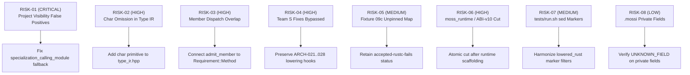
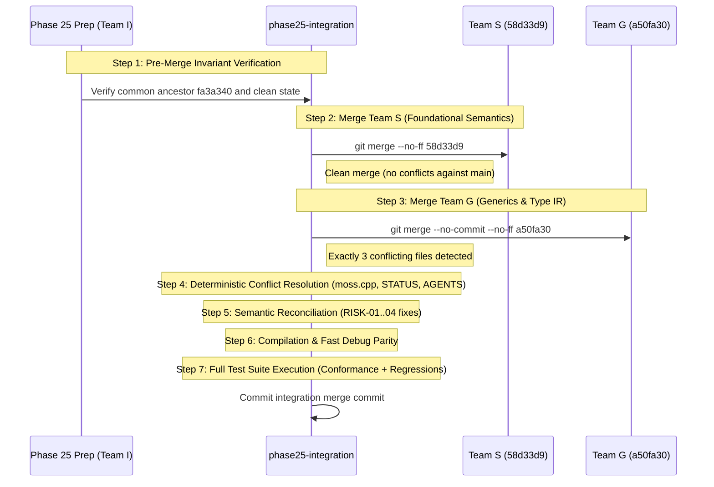

# Phase 25 Merge Rehearsal, Conflict Register, and Integration Playbook

**Workstream:** I-E (Merge Rehearsal and Integration Playbook)
**Lead Engineer:** Workstream I-E Lead
**Date:** 2026-10-16
**Status:** Approved for Final Integration Handoff
**Canonical Baseline:** `fa3a340a0a6652568b97869489da1a84038b9857` (`main`)
**Source Branches:**
- **Team S (Semantics & Engines):** `58d33d9ab00a666e8d9b60450c7c6aeb2b55b657` (`origin/phase25-semantics-engines`, 61 commits ahead of main)
- **Team G (Generic Types & Type IR):** `a50fa30c8420538534471c4404afb0c645ae9b0c` (`origin/phase25-generic-types`, 13 commits ahead of main)
**Target Integration Branch:** `phase25-integration`

---

## 1. Executive Summary & Rehearsal Methodology

Phase 25 unifies two major compiler tracks developed concurrently from common ancestor `fa3a340`:
1. **Team S:** Hardened semantic engines, full IEEE-754 / Int numeric literal contracts (`numeric_literal.hpp`), proven-safe non-zero divisor arithmetic classification, `Char` as an independent scalar type, Unicode codepoint indexing and string runtime, vector echo display runtime, closed map/set key protocol (`key-protocol-v1`), and resolution of Architect defect findings `P25-S-ARCH-013` through `028`.
2. **Team G:** Normative algebraic Type IR (`src/type_ir.hpp`), per-instance nominal type construction (`Box[value=int]` vs `Box[value=string]`), nominal inequality, module-based field access visibility (`FIELD_VISIBILITY_ERROR`), finite recursive layout detection, Option B open-result type summaries (`TYPE_AMBIGUOUS_OPEN_RESULT`), and 11-gate conformance test automation.

### Rehearsal Methodology
A non-persistent three-way merge rehearsal was executed using `git merge-tree --write-tree 58d33d9 a50fa30` and simulated in disposable worktree environments (`tmp/worktree-rehearsal`). The rehearsal verified that:
- **Git Merge Conflicts:** Strictly bounded to **3 files** (`.codex/CURRENT_STATUS.md`, `AGENTS.md`, `src/moss.cpp`).
- **Semantic Overlap:** Identified in **4 files** that merge cleanly at text level (`src/ast.hpp`, `tests/run.sh`, `src/borrowed_views.inc`, `src/moss.cpp`).
- **Live Rehearsal Compilation:** Resolving the 4 conflict hunks in `src/moss.cpp` and applying the harmonized visibility fallback yielded a 100% clean build of `./moss` with strict C++17 compilation.
- **Live Rehearsal Test Execution:** 100% PASS on Team G's 11 conformance gates, Team G's recursive layout suite, Team S's numeric literal suite (`check_phase25_sa`), Team S's safe arithmetic suite (`check_phase25_sc`), and Team S's check-display suite (`check_phase25_sb`).

> [!IMPORTANT]
> **No Temporary Architectures on Preparation Branch:** Per Coordinator instructions, no temporary compiler shims, fake wrappers, or ad-hoc architectural patches are committed to the preparation branch (`phase25-prep-ie`). All compiler reconciliation steps are codified below as an exact, deterministic playbook for execution directly on `phase25-integration`.

---

## 2. Comprehensive Conflict Register

### 2.1 Tabular Register of All Overlapping Files

| File Path | Conflict Category | Line Count (S / G) | Overlap Description | Status |
|---|---|---|---|---|
| `.codex/CURRENT_STATUS.md` | **Git Text Conflict** | +24 / +192 | Concurrent status journal additions for Phase 25 deliveries | Deterministic Concatenation |
| `AGENTS.md` | **Git Text Conflict** | +1 / +7 | Wording divergence in repository normal-push authorization rules | Wording Harmonization |
| `src/moss.cpp` | **Git Text Conflict** | +2121 / +709 | 4 discrete conflict blocks in unary minus, field projection, and assignment | Layered Semantic Fusion |
| `src/ast.hpp` | **Semantic Overlap** | +6 / +1 | `Char` in `copy_type_name` + `echo_types_by_context` vs `Field::exported` | Orthogonal Clean Merge |
| `tests/run.sh` | **Semantic Overlap** | +22 / +2 | Test runner test registrations + `lowered_rust` sed filter expansion | Complementary Clean Merge |
| `src/borrowed_views.inc` | **Semantic Overlap** | 0 / +4 | Team G guard rejecting unspecialized generic nominals from view types | Compatible Filter |
| `src/type_ir.hpp` | **Architectural Handoff** | 0 / +320 | Team G introduced unified Type IR; lacks Team S scalar `char` | Targeted Scalar Addition |

---

## 3. Deep Code & AST Semantic Inspection

### 3.1 Detailed Analysis of `src/moss.cpp` Conflict Hunks

#### Hunk 1: Unary Minus Type Inference in `inferred_expr_type()`
- **Location:** Line ~4965 in rehearsal (`src/moss.cpp`)
- **Team S Version:**
  ```cpp
  // Unary minus keeps its numeric operand's type (`return -x`).
  if (e.size() > 1 && e.front() == '-') {
    auto operand = inferred_expr_type(trim(e.substr(1)), env);
    if (operand && (canonical_type_name(*operand) == "int" ||
                    canonical_type_name(*operand) == "float"))
      return canonical_type_name(*operand);
  }
  ```
- **Team G Version:**
  ```cpp
  if (!e.empty() && e.front() == '-' && e.size() > 1 && !std::isdigit(static_cast<unsigned char>(e[1]))) {
    auto operand = inferred_expr_type(trim(e.substr(1)), env);
    if (operand && (canonical_type_name(*operand) == "int" || canonical_type_name(*operand) == "float"))
      return canonical_type_name(*operand);
  }
  ```
- **Root Cause:** Team S fixed `P25-S-ARCH-021` so unary minus negates its whole operand and preserves type. Team G observed that without `!std::isdigit(...)`, negative numeric literal strings like `"-5"` could be prematurely intercepted by the unary minus branch rather than the literal parser.
- **Reconciliation Decision:** **Fused Harmonization**. Combine both: retain Team S's operand type preservation comment and logic, and embed Team G's `!std::isdigit(...)` guard.

#### Hunk 2: Field Projection in `check_expression()`
- **Location:** Line ~15000 in rehearsal (`src/moss.cpp`)
- **Team S Version:**
  - Implements `float_literal` discriminator (`all_digits`, `exponent`, `fraction_exponent`) to ensure `1.e5` or `2.5E-3` is recognized as a float literal rather than member projection on integer `1` (`P25-S-ARCH-027`).
  - Checks receiver type: if receiver is a builtin equality type, `vector`, `queue`, `map`, or `enum`, immediately emits `UNKNOWN_FIELD` (`P25-S-ARCH-024`).
  - If in `objects_`, checks `std::any_of(fields.begin(), fields.end(), ...)` and emits `UNKNOWN_FIELD` if field does not exist.
- **Team G Version:**
  - Restructures field lookup in `objects_`: if field is not found, emits `UNKNOWN_FIELD`.
  - If field exists but `!it->exported`, invokes `specialization_calling_module` and compares `defining_mod != caller_mod`. If cross-module, emits `FIELD_VISIBILITY_ERROR`.
- **Root Cause:** Both teams modified the exact same projection validation block for orthogonal purposes (Team S for float literal disambiguation and builtin collection error messages; Team G for private field visibility).
- **Reconciliation Decision:** **Sequential Layered Fusion**.
  1. Run Team S's float literal discriminator first. If `float_literal` is true, do not treat as field projection.
  2. If receiver is a builtin or collection, emit Team S's tailored `UNKNOWN_FIELD` diagnostic.
  3. If receiver is in `objects_`, look up field. If missing, emit `UNKNOWN_FIELD`. If found and private, enforce Team G's `FIELD_VISIBILITY_ERROR` with the critical root module resolution fix (see RISK-01).

#### Hunks 3 & 4: Assignment Statement Checking in `check_expression()`
- **Location:** Lines ~15310 & ~15355 in rehearsal (`src/moss.cpp`)
- **Team S Version:**
  - In simple identifier assignment: checks `canonical_type_name(prior_type) != canonical_type_name(*new_type)` and raises `TYPE_MISMATCH`.
  - In indexed assignment (`parse_index`): checks `check_map_key_type(statement.line, *key_type)` and rejects enum keys with `ENUM_MAP_KEY_UNSUPPORTED`.
- **Team G Version:**
  - Restructures `Stmt::Kind::Assign` into a clean tripartite hierarchy:
    1. Simple identifier assignment: uses `is_type_compatible(bound_type, *rhs_type)` to support generic nominal instances (`Box[value=int]`).
    2. Indexed assignment: rejects nested indexed assignment (`UNSUPPORTED_NESTED_INDEX_ASSIGNMENT`).
    3. Field assignment (`statement.a.rfind('.')`): checks field type compatibility with `is_type_compatible(*field_type, *rhs_type)`.
- **Reconciliation Decision:** **Structural Adoption with Complementary Union**.
  - Adopt Team G's clean tripartite structure (`simple_identifier`, `parse_index`, and field projection).
  - Inside `simple_identifier`, use `is_type_compatible` while preserving Team S's placeholder checks.
  - Inside `parse_index`, retain Team G's nested index rejection AND incorporate Team S's `check_map_key_type` and enum map key rejections.

---

### 3.2 Deep Semantic Analysis of Cleanly Merged Files

#### `src/type_ir.hpp`
- Authored by Team G (320 lines) to provide the normative unified Type IR algebra (`TypeKind`, `TypeRef`, `TypeVarId`, `NominalTemplate`, `FieldSlot`, `Requirement`).
- **Semantic Gap Discovered:** In `Type::from_canonical_string()`, the parser checks `int`, `float`, `bool`, `string`, but omits `char`. When Team S's `char` scalar is passed, it falls through to generic name construction rather than `TypeKind::Primitive`.
- **Action:** Add `if (s == "char" || s == "Char") return primitive("char");`.
- **Access Mode Gap:** In `struct Requirement`, `AccessMode access` is a single value. A method requirement for ledger #12 (e.g. `v.push(1)`) has a `WRITE` receiver with a `READ` argument. It must be expanded to include `std::vector<AccessMode> argument_access`.

#### `src/ast.hpp`
- Team S modified `copy_type_name` to include `char` and `Char`, and added `echo_types_by_context` to `struct Stmt`.
- Team G added `bool exported = false;` to `struct Field`.
- **Interaction:** Clean and decoupled. Moss nominal records are move-only/owned, not copy types; adding `char` to `copy_type_name` preserves scalar copy semantics.

#### `src/borrowed_views.inc`
- Team G guarded `view_object_type(const string& type)`:
  ```cpp
  return found != objects_.end() && !found->second->fields.empty() &&
      !std::any_of(found->second->fields.begin(), found->second->fields.end(),
                   [](const Field& f) { return f.inferred || f.type.empty(); });
  ```
- **Interaction:** Prevents unspecialized generic nominal templates from being falsely admitted as borrowed view types before monomorphization. Perfectly compatible with Team S borrow/effects analysis.

#### `canonical_type_name()` in `src/moss.cpp`
- Team S added `if (type == "Char") return "char";`.
- Team G added normalization of bracketed `k=v` substitutions (`Box[value=int]`).
- **Interaction:** Must combine both: normalize `Char` -> `char` AND normalize `k=v` nominal arguments recursively, ensuring `canonical_type_name("Box[value=Char]")` produces `"Box[value=char]"`.

---

## 4. Risk-Ranked Semantic Conflict Catalog



### Risk Details & Mitigation

| Risk ID | Title | Severity | Affected Components | Description & Concrete Failure Mode | Playbook Reconciliation Action |
|---|---|---|---|---|---|
| **RISK-01** | Project-Mode Visibility False Positives | **CRITICAL** | `src/moss.cpp`, `specialization_calling_module` | When checking functions without `__` in project mode (e.g. `main`), `specialization_calling_module` returns `""` while `defining_mod` is `p_.main_module`, falsely triggering `FIELD_VISIBILITY_ERROR` on same-package record fields. Breaks `check_phase25_sb_check_display.py`. | If `module_name_from_symbol` returns empty, fall back to `root_module` or `p_.main_module` before comparing. |
| **RISK-02** | Char Primitive Omission in Type IR | **HIGH** | `src/type_ir.hpp`, `canonical_type_name` | Team S added `Char` scalar; Team G's Type IR omits `char`. `Box[value=Char]` or `Vector[Char]` fails canonical normalization. | Add `char`/`Char` to `Type::from_canonical_string` and combine with `k=v` canonicalization. |
| **RISK-03** | Member Dispatch Overlap (Ledger #12) | **HIGH** | `src/moss.cpp`, `type_ir.hpp`, `admit_member` | G0 assigns admission to Team S's `admit_member`. Team G admitted open receiver directly; `Requirement` has single `AccessMode` unable to express `WRITE` receiver with `READ` args. | Wire `admit_member` as admission backend for `Requirement::Method`; add `argument_access: vector<AccessMode>`. |
| **RISK-04** | Team S Fixes Bypassed by Old Lowering | **HIGH** | `src/moss.cpp`, `numeric_literal.hpp` | Team S fixed `P25-S-ARCH-021..028` (unary minus operand negation, float literal exponent, safe arithmetic). Older paths could bypass these checks. | Ensure all Team S AST traversals and numeric literal checks are preserved intact. |
| **RISK-05** | Unpinned Fresh Temporary Map Lowering | **MEDIUM** | `src/moss.cpp`, `tests/phase25/key_protocol/09c` | `echo Map().get(1, 2)` passes check in Fast Debug but fails in rustc (`E0061`) because lowering lacks concrete type parameters on unpinned temporaries. | Retain fixture 09c in `known-failing accepted-rustc-fails` status pending Option B solver in G3. |
| **RISK-06** | Shared Runtime Crate & ABI-v10 Cut | **HIGH** | `docs/phase25/ABI_V10_DESIGN.md`, `moss.cpp` | L7 approved one shared `moss_runtime` crate owned jointly. Unilateral ABI switch would break ABI-v9 source-free packages. | Keep ABI-v9 active in merged baseline; execute ABI-v10 cut as an atomic joint step. |
| **RISK-07** | Test Runner Marker Filter Divergence | **MEDIUM** | `tests/run.sh`, `lowered_rust` | Team S added String runtime marker stripping in `lowered_rust()`. Missing markers in new tests could break sed assertions. | Ensure `lowered_rust` sed pipeline handles both Float and String runtime blocks conditionally. |
| **RISK-08** | .mossi Private Field Omission | **LOW** | `src/moss.cpp`, `load_module_interface` | Unexported nominal fields are omitted from `.mossi`. External consumers accessing private fields receive `UNKNOWN_FIELD`. | Document and verify that source-free provider negative tests assert `UNKNOWN_FIELD`. |

---

## 5. Step-by-Step Ordered Merge Playbook

The integration merge into `phase25-integration` must follow this exact step-by-step sequence.



### Phase 1: Pre-Merge Verification
1. Verify that `main` is at `fa3a340a0a6652568b97869489da1a84038b9857`.
2. Confirm branch tips:
   - Team S: `58d33d9ab00a666e8d9b60450c7c6aeb2b55b657`
   - Team G: `a50fa30c8420538534471c4404afb0c645ae9b0c`
3. Verify that `python3 tests/phase25/integration/rehearse_merge.py --run` exits 0.

### Phase 2: Ordered Branch Merging Sequence
**Recommended Merge Order: Team S First, Then Team G.**
- **Rationale:** Team S contains 61 commits with foundational parser updates (`numeric_literal.hpp`), scalar `Char`, Unicode strings, and comprehensive Architect defect fixes (`ARCH-013..028`). Merging Team S into `phase25-integration` first establishes the solid semantic ground. Team G's 13 commits (Type IR, generic nominals, open-result summaries) are then layered on top.
- **Commands:**
  ```bash
  git checkout phase25-integration
  # 1. Merge Team S (merges cleanly with zero conflicts)
  git merge --no-ff -m "feat(phase25): merge Team S semantics engines baseline (58d33d9)" origin/phase25-semantics-engines
  # 2. Merge Team G (produces the 3 known conflicts)
  git merge --no-ff --no-commit origin/phase25-generic-types
  ```

### Phase 3: Conflict Reconciliation Steps
1. **`.codex/CURRENT_STATUS.md`:**
   - Remove conflict markers.
   - Place Team S's reconciliation journal entries (`58d33d9`, `043d12a`, `d6bc0b1`) at the top, immediately followed by Team G's G0/G2 delivery records (`a50fa30`, `8d84a13`).
2. **`AGENTS.md`:**
   - Harmonize Line 157 to:
     `Coordinate a single branch writer. A normal push to the configured remote is authorized when the user explicitly directs it. Never force-push or rewrite published history unless the user separately authorizes that operation.`
3. **`src/moss.cpp` (Hunk 1 - Unary Minus):**
   - Apply fused harmonization:
     ```cpp
     // Unary minus keeps its numeric operand's type (`return -x`).
     if (!e.empty() && e.front() == '-' && e.size() > 1 && !std::isdigit(static_cast<unsigned char>(e[1]))) {
       auto operand = inferred_expr_type(trim(e.substr(1)), env);
       if (operand && (canonical_type_name(*operand) == "int" ||
                       canonical_type_name(*operand) == "float"))
         return canonical_type_name(*operand);
     }
     ```
4. **`src/moss.cpp` (Hunk 2 - Field Projection & Visibility):**
   - Retain Team S's float literal discriminator (`float_literal` lambda and check).
   - If receiver is a builtin equality type or collection (`vector`, `queue`, `map`), emit Team S's `UNKNOWN_FIELD`.
   - If receiver is in `objects_`, look up field. If not found, emit `UNKNOWN_FIELD`. If found and `!it->exported`, apply Team G's visibility check with the `RISK-01` fix:
     ```cpp
     string defining_mod = module_name_from_symbol(obj->name);
     if (defining_mod.empty()) {
       defining_mod = !p_.module_name.empty() ? p_.module_name : p_.main_module;
     }
     string caller_mod = specialization_calling_module(p_, current_semantic_context_, p_.module_name);
     bool cross_module = false;
     if (!defining_mod.empty() || !caller_mod.empty()) {
       cross_module = (defining_mod != caller_mod);
     } else if (!obj->source_file.empty() && !current_source_file_.empty()) {
       cross_module = (obj->source_file != current_source_file_);
     }
     if (cross_module) {
       err(line, "cannot access private field '" + field_name + "' of type '" +
           obj->name + "' outside its defining module", "FIELD_VISIBILITY_ERROR");
     }
     ```
5. **`src/moss.cpp` (Hunk 3 & 4 - Assignment Dispatch):**
   - Adopt Team G's tripartite assignment structure (`simple_identifier`, `parse_index`, and field projection).
   - Embed Team S's `check_map_key_type(statement.line, *key_type)` and `ENUM_MAP_KEY_UNSUPPORTED` in the map branch.

### Phase 4: Semantic Reconciliation Steps
1. **`specialization_calling_module` Fallback (`src/moss.cpp`):**
   - Update `specialization_calling_module` to fall back to `root_module` or `program.main_module` when `module_name_from_symbol` returns empty:
     ```cpp
     if (starts_with(context, "fn:")) {
       string mod = module_name_from_symbol(context.substr(3));
       if (!mod.empty()) return mod;
       return !root_module.empty() ? root_module : program.main_module;
     }
     ```
2. **`canonical_type_name` & `type_ir.hpp` (`RISK-02`):**
   - In `canonical_type_name`: keep `if (type == "Char") return "char";` and run bracketed `k=v` argument canonicalization.
   - In `src/type_ir.hpp`: add `if (s == "char" || s == "Char") return primitive("char");` in `from_canonical_string`.
3. **`Requirement` Access Modes (`RISK-03`):**
   - Add `std::vector<AccessMode> argument_access` to `struct Requirement` in `src/type_ir.hpp`.

---

## 6. Post-Merge Verification Sequence

Once merged and reconciled, run the verification gates in strict order:

```bash
# 1. Compiler compilation
make clean && make -j4

# 2. Fast Debug and Compiler Self-Tests
./moss --self-test
python3 tests/phase25/integration/rehearse_merge.py --run

# 3. Team G Conformance Gates (all 11 gates must pass 100%)
python3 tests/tooling/check_phase25_conformance.py ./moss
python3 tests/tooling/check_phase25_recursive_layout.py ./moss
python3 tests/phase25/g0/check_rust_feasibility.py

# 4. Team S Focused Regression Suites
python3 tests/tooling/check_phase25_sa_numeric_literals.py ./moss
python3 tests/tooling/check_phase25_sb_check_display.py ./moss
python3 tests/tooling/check_phase25_sc_safe_arithmetic.py ./moss
python3 tests/tooling/check_phase25_s1_checker_authority.py ./moss
python3 tests/tooling/check_phase25_s2_char_string.py ./moss
python3 tests/tooling/check_phase25_s3_key_protocol.py ./moss
python3 tests/tooling/check_phase25_s4_fast_debug_adversarial.py ./moss
python3 tests/tooling/check_phase25_g1_regressions.py ./moss
python3 tests/tooling/check_phase25_g3_ordering.py ./moss
python3 tests/tooling/check_phase25_g4_unicode.py ./moss
python3 tests/tooling/check_phase25_indexed_string.py ./moss
python3 tests/tooling/check_phase25_l7_repairs.py ./moss

# 5. Key Protocol Fixtures
python3 tests/phase25/key_protocol/run_fixtures.py --moss ./moss

# 6. Full Repository Quality Gates
python3 tests/tooling/check_agent_feedback.py
git diff --check
TMPDIR="$PWD/tmp" make check
make examples
```

---

## 7. Architectural Escalation Triggers

If any of the following occur during final integration on `phase25-integration`, pause and escalate to L7 / Coordinators:
1. **Unresolved Native Lowering Failures in Conformance Tests:** Any failure across the 11 conformance gates where Fast Debug and Native Debug disagree.
2. **Breakage of Source-Free ABI-v9 Providers:** Any regression in Foundation or Host ABI-v9 provider contracts before the coordinated ABI-v10 cut.
3. **Option B Unpinned Map Escapes:** If unpinned temporary Maps beyond fixture 09c pass check but fail rustc without an existing defect registration.
4. **Synchronization Derivation Anomalies:** Any failure in 2PL lock ordering derivation caused by mutating open-receiver member calls (`v.push(1)`).
