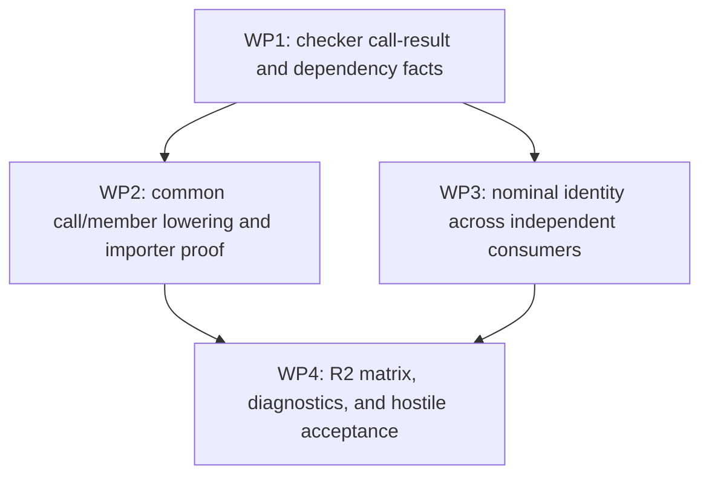

# Phase 25.1 R2 execution plan

**Planning baseline:** `d289024c7c578de26ba670d4bd477ba90609c23e`
**State:** L7 authorized execution after R1.1. Planning review GO at
`6cd9cf7f66b4a26b235c313153eba3019eac1910`. R1.1 is complete at
`ec0f64d5`; WP1 through WP4 have pushed implementation checkpoints. The final
bounded R2 matrix passed on `2f1647b7`, and the architect issued implementation
GO on that exact HEAD. L7 accepted R2 and authorized R3 on 2026-10-22.

The coordinator's detailed result and remaining R3–R5 gaps are recorded in
`.codex/CURRENT_STATUS.md` and `PHASE_25_1_REMAINING_WORK.md`. Preserve the
L7-accepted R1/R2 behavior during R3.

## R2 objectives from the established plan

R2 closes open results, selected member constraints, and generic composition:

- Source-free ABI-v10 `fresh(): return []` for independently inferred concrete
  element types, plus `relay(): return fresh()`, multi-hop chains, and private
  helper dependency closure including zero-argument calls.
- `size(value): return value.length()` and selected statically resolved generic
  member requirements.
- Preserve the passing generic parameter/scalar/field/arithmetic/direct-call
  profiles. Prove provider-owned nominal type identity, receiver/template
  visibility, and sharing across independently compiled consumers.
- Reject open-result ambiguity/conflicts and unsupported methods with correct
  requirement-chain and provider/consumer diagnostics.
- Require provider-source deletion, selected legacy-body poisoning, checked
  projection trace, distinguishable concrete specializations, and native
  Debug/Release execution for each positive. Hostile cases mutate callable,
  body, requirement, dependency, and provenance identity.
- The only v10 opt-in is `MOSS_STAGED_ABI=v10`.

## Accepted prerequisites

- L7 accepted and froze the R1 shadowed-return and generic Vector-`For`
  stabilization at `d289024c`; M2b2 source-free/hostile corpus passes.
- The checked-body-v1 bounded codec, canonical hash checks, local/branch
  identities, common occurrence lowerer, generic arithmetic, homogeneous
  Vector relation, direct call, zero-argument one-hop relay, and tested H3
  private/nominal chains are available as existing infrastructure.
- `fresh()` and one-hop `relay()` each pass Int/Bool Debug and Release in the
  current R0 refresh. Treat these as regression controls, not open work.
- ABI-v9 remains the default. No source generic declarations, dynamic
  dispatch, new ABI version, or compiler-wide rewrite is in scope.

## Bounded work packages and dependency DAG

### WP1 — Checker authority for call results and closure — complete

Extend the existing checked occurrence/summary facts only where the current
R2 cases expose a gap. Link each call result to its exact selected callable,
ordered checked arguments, result TypeRef, access/effects, and private
dependency. Retain the full result relation through zero-argument and nested
calls. Preserve the already passing `fresh` and one-hop `relay` profiles.

**Positive tests:** a three-function zero-argument chain returning
`Vector[T]`, direct helper result, Int/String or Bool/String consumers in
  separate source-free runs.
**Hostile tests:** missing intermediate summary/body, wrong or duplicate
callable identity, duplicate body record, result TypeRef substitution,
reordered/forged arguments, missing/duplicate dependency, altered dependency
hash, and stale provenance. Each must reject before projection.

**Implementation evidence:** `tests/tooling/check_phase25_r2_wp1_call_chain.py`
builds a zero-argument `relay -> middle -> fresh` provider, deletes source,
poisons all three legacy bodies, and verifies independent `Vector[Int]` and
`Vector[Bool]` source-free Debug/Release consumers plus ABI-v9 controls. Hostile
tests reseal the parent relay dependency when mutating intermediate body
identity or result type. The exact WP1 diff received architect scoped GO with
no P0/P1/P2. Canonical writer rejection cases are labeled separately from
consumer importer rejection.

### WP2 — Common call/member representation and imported proof

Use the same call-expression and requirement path for direct calls and
selected member calls. Add the String `length()` profile by retaining the
checker-selected member identity, receiver and result TypeRefs, access, and
observable effects. The importer must validate substitutions from exact
checked types; it must not reconstruct a member from display text or infer a
result from its name.

**Positive tests:** `size(value): return value.length()` for String in
source-free Debug/Release, with the current direct-call/arithmetic controls.
**Hostile tests:** wrong member identity, receiver/result TypeRef, access,
effect, duplicate selected requirement/constraint records, and requirement
order; ordinary source diagnostics for unsupported methods and
ambiguous/conflicting open results.

### WP3 — Provider-owned nominal identity across independent consumers

Reuse WP1's same-provider call-result and private-dependency proof. Extend the
current bounded generic record proof to two independently built consumer
crates using the same provider-owned type identity. Validate constructor
declaration identity, field ordinal/type links, visibility and provider
identity at import. Moss still has static structural dispatch; this package
does not add user generic declarations or dynamic nominal methods.

**Positive tests:** two consumers specialize the same exported Box-like
provider record with different concrete field types after source deletion.
**Hostile tests:** substitute or duplicate the nominal declaration/provider
identity, field ordinal/type, visibility, or dependency/provider hash; reject
before projection.

### WP4 — R2 acceptance matrix and harness integrity

The oracle now gives the Map-parameter surface probe a distinct ID, records
mode-specific expected source/v9/v10 outputs for negative controls, and checks
combined inventories for duplicate IDs and missing source/v9 expectations.
The self-test covers corpus plus surface probes, duplicate-ID rejection, and
both accepted fail-closed and unexpected-output result classification; the
oracle exits nonzero for any unexpected build, output, or projection status.
Provider-stage rejection is unexpected when a case requires a v10 provider
artifact; expected provider-stage rejection remains valid for other controls.
The bounded R2 call/member/nominal matrix ran against frozen candidate
`2f1647b7` in native Debug and Release with ABI-v9 controls. Source-backed and
ABI-v9 passed all six selected matrix cases. ABI-v10 passed empty Vector
result, zero-argument relay, String member, nominal constructor, and local Map
profiles in both modes; the Map-parameter surface profile remained correctly
classified as unavailable. Callback-result and non-loop Count controls pass
source-backed/ABI-v9, with expected v10 provider/consumer rejection stages.
All matrix reports had zero unexpected results.

**Completion tests:** all positives have removed provider source, poisoned
selected legacy records, and a checked projection trace. All hostile mutations
reject before projection. Open-result ambiguity, type conflict, and unsupported
member cases retain their source-level diagnostics. No per-shape opt-in is
needed beyond `MOSS_STAGED_ABI=v10`. WP1-WP3 harnesses, M2b2, checked-body IR,
G2 conformance (11/11), source diagnostics, and the final architect review are
complete. The architect recorded GO with no open P0/P1/P2 findings at
`2f1647b7`; L7 retains final R2 acceptance authority.

## Sequencing and ownership

Keep the existing L6 Coordinator as the single compiler-code writer. WP1
precedes WP2 and WP3; WP4 follows both. These packages touch the same checker,
ABI-v10 summary builder, common lowerer, and importer in `src/moss.cpp` and
`src/checked_body_ir.hpp`, so parallel compiler writers would increase
integration risk without independent semantic ownership. The existing
Adversarial Architect reviews this inventory/plan once, then reviews the
frozen R2 implementation checkpoint under the established cadence. A separate
read-only inventory task is unnecessary for this bounded R2 slice.

R3–R5 are downstream milestones and are not part of this R2 plan. See the
remaining-work ledger and established readiness plan for their acceptance
requirements. Do not change the default ABI or merge to main.

## Stop and escalation rules

No language-design decision is currently required. Preserve the bounded
checker-owned contracts and fail-closed admission. If a required relation
cannot fit an append-only checked-body-v1 node or the change would alter
ABI-v10 meaning, stop and request L7 direction before implementation. This
work continues under L7's R2 execution authorization. Do not start R3.
