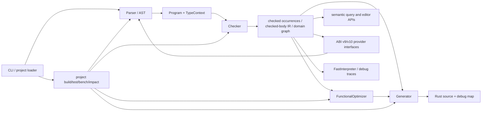
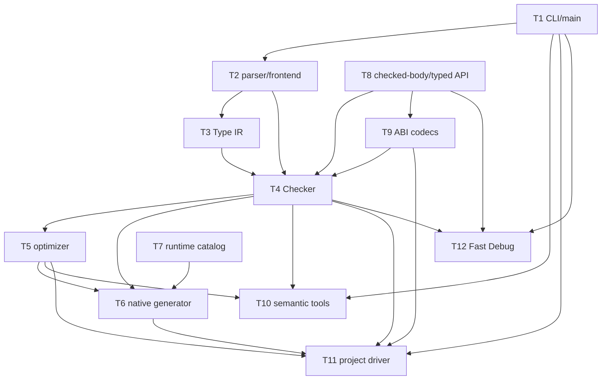

# Phase 25.2 G0 — compiler architecture and TU dependency map

**Baseline:** accepted Phase 25.1 checkpoint `2420439cf1cbaa08c8cd45d0d77b436ea4fb43f0` (`origin/main` was fetched and matched exactly before this inspection). **Scope:** source inspection only; no compiler or build behavior changes. **Compiler contract:** `./moss agent bootstrap --json` reports `language_version: moss-0.1`.

## Evidence and current shape

The inspection was performed against that checkpoint with `wc`, `rg` include/symbol searches, and direct reads of class and include boundaries. `src/moss.cpp` is 63,837 lines / 3,099,343 bytes. The six largest semantic headers total 443,861 bytes: `interpreter.hpp` 134,047; `checked_body_ir.hpp` 103,327; `abi_v10_records.hpp` 92,515; `type_ir.hpp` 53,913; `ast.hpp` 38,821; `typed_semantic_api.hpp` 21,238. The compiler build reports two existing `TypeSolver::Undo::binding` missing-initializer warnings (`src/type_ir.hpp:1090,1136`).

The production compiler is one C++17 translation unit: `Makefile` compiles only `src/moss.cpp`. It includes the headers at `src/moss.cpp:1-53`, opens `namespace moss` at line 58, and closes it at line 62008. `main` and Fast Debug dispatch are outside that namespace near lines 62054-63837. There are 471 `static` functions in `moss.cpp` by a line-anchored search, so most current non-class functions have internal linkage. Source/header macros are nearly absent; the only conditional compiler macro block found in `moss.cpp` is the Linux `/proc/self/exe` probe at lines 62033-62037.

### Current logical ownership blocks

| Current source block | Evidence anchors | Responsibility and owned state |
| --- | --- | --- |
| Shared compiler helpers and type spelling adapters | `moss.cpp:60-1754` | Compiler version/profile switches, source normalization, module/type identity helpers, operator/builtin descriptors, specialization identities, ABI parameter passing, parsed functional pipeline records, and `TypeEnv`. `TypeEnv` owns bindings/terms and bridges legacy spelling maps to `TypeRef`. |
| Frontend | `Parser` at `moss.cpp:1755`; `lex_lines` at 2735; `SourceFileScope` at 2836 | Physical source lines/tokens to AST nodes; file/module annotations and parser helpers. Parser methods construct `Program` and nested `Stmt`/`Expr` structures. |
| Typed semantic checker | `Checker` at `moss.cpp:7811` through its close around 38380 | Type/effect/ownership validation; declaration tables and specialized function/domain lookup; concrete domain graph; checked occurrence and checked-body production; structural constraints; file/Executor and synchronization plan admission. Owns many pointer-keyed maps into the current `Program` and AST. |
| Functional analysis/optimization | `FunctionalOptimizer` at 38391-39759 | Consumes checked `Program` facts and owns the per-program functional pipeline/optimization plan consumed by native generation and tooling. |
| Native generator | `Generator` at 39765 through roughly 46935 | Owns Rust output buffers, name/specialization maps, current domain/handler and expression-lowering context, debug provenance, physical synchronization plan projections, and all final codegen decisions. ABI-v9 remains default (`kNativeAbiVersion = 9` at line 81); staged ABI-v10 is selected by an environment gate at lines 82-88. |
| Semantic APIs and developer tools | `moss.cpp:46937-51227` | Query facts, target resolution, inspect/type/effects/ownership/calls/why/cost projections, capabilities/schema and completion. These consume compiler-owned facts rather than recomputing analysis. |
| Project/module/ABI/build orchestration | `moss.cpp:51229-62007` | Manifest/toolchain/process helpers; project parsing/build/test/bench; module graph and imports; source-free ABI-v9/v10 interfaces, provider validation/cache identity; affected-test snapshots, impact, semantic edits and formatting. `run_project_command` is at line 61825. |
| Fast Debug and executable entry | `moss.cpp:62054-63837` | CLI dispatch, Fast Interpreter entry/testing, FileIO preflight, trace/debug-query execution, then `main`. It consumes the same checked Program, but has its own runtime execution state. |

These are logical ranges, not exact future file partitions. Several helper definitions sit before their consumer class because their current `static` helpers and inline call sites evolved in one file.

## Ownership and cross-subsystem call/data flow

The core production flow is:

`Program` in `ast.hpp:807+` is the shared semantic aggregate: declarations, functions, routes, imports, tests/benchmarks, call/use edges and the shared `TypeContext`. `Function`, `Domain`, `Stmt`, and `Expr` records are address-referenced by checked-body state, call maps, generator side tables, and snapshots. `Checker` builds maps of `Function*`, `Domain*`, and `ObjectType*` from vectors in `Program`; its checked body state also uses AST body addresses. `Generator` reads the exact checked program and stored `FunctionalPipeline`/`OptimizationPlan`; it is not an independent type/effect authority. `typed_semantic_api.hpp:194` projects public typed semantics from `Program`. Project compilation composes modules into the same checker/generator path rather than a second semantic pipeline (see `moss.cpp:52094-52100` and `55579-55584`).

### Type and Phase 25 ownership constraints

- `TypeRef` is an immutable shared reference to a type node; `TypeContext` (in `type_ir.hpp:120+`) interns and binds identities, and `TypeSolver` (line 1064) mutates inference bindings with rollback trails. Preserve one context identity for a whole checked module/program set; do not split by making duplicate per-TU registries or reconstructing terms from strings at internal boundaries.
- `TypeSolver::Trail`/undo records and TypeVar identity are solver-local mutable state. A solver should remain owned by one inference/check invocation. Export narrow operations or move non-template method bodies; do not share a mutable solver across concurrent project builds.
- Phase 25 typed semantics in `typed_semantic_api.hpp` are a projection over the checked `Program`. Phase 25.1 checked-body IR in `checked_body_ir.hpp` carries canonical expression/statement occurrences, semantic dependencies and type/effect facts. Both must retain provider/source identities and deterministic canonical encoding/hashes.
- ABI v9 and v10 have intentionally separate contracts. `source_free_abi_v9.hpp` and `source_free_abi_v10.hpp` contain public wire types; `abi_v10_records.hpp` (2,069 lines) owns record framing/parsing/encoding helpers and depends on both source-free v9 types and checked-body/types. `moss.cpp` currently stages ABI-v10 behind `MOSS_STAGED_ABI=v10`; ABI-v9 stays the default. No ABI schema or default change is part of this extraction.
- Fast Debug's `FastInterpreter` is in `interpreter.hpp`; its execution environment, event/trace storage and domain runtime are instance state, not compiler global state. It consumes AST/semantic records and needs runtime parity with generated Rust. `moss.cpp` handles source/test entry and trace/debug query orchestration.
- Native lowering in `Generator` projects the checked Program, optimizer plan, source-free provider identities, runtime snippets, debug map, and lock/synchronization plan. Keep generation deterministic and retain exact source provenance, ABI fingerprint and output path behavior.

## Header, template, and `.inc` dependency findings

The main source includes every production header, so translation alone currently instantiates their inline bodies in the compiler TU. Most headers have explicit standard-library includes and `namespace moss`; several deliberately implement functions in headers:

| Header | Current responsibility / notable implementation | Extraction feasibility and cautions |
| --- | --- | --- |
| `ast.hpp` (897 lines) | Full AST/Program records, `Program` maps/vectors, inline copy-type and context helpers. | Keep data-layout declarations shared; move larger pure helper bodies only after finding all direct test/tool includes. AST definition order and source identity fields are foundational. |
| `type_ir.hpp` (1,345 lines) | `TypeRef`, `TypeContext`, structural identity/hash/formatting, inference terms and `TypeSolver`. | Strong candidate for moving non-template bodies to `type_ir.cpp`; preserve type-node interning, nominal declaration IDs, and no ODR duplication of context/static registries. Split only after the header declarations/API are stabilized. |
| `typed_semantic_api.hpp` (429 lines) | Semantic API records and inline `project_typed_semantics_v1(const Program&)`. | High-value extraction candidate: projection is non-template and single-purpose. Keep result types stable and avoid hidden dependency on Checker internals. |
| `checked_body_ir.hpp` (2,318 lines) | Checked-body structures, canonical encode/decode/hash, legacy projection and dependency closure validation; includes `ast.hpp`, ABI-v9 wire types and Type IR. | Large non-template codec/validation implementation is feasible in `.cpp`, but many tests include it directly and its public structs are the source-free verifier contract. Partition declaration and implementation carefully; preserve canonical byte/hash and fail-closed checks. |
| `abi_v10_records.hpp` (2,069 lines) | ABI-v10 record variants, section model, encoding/decoding, validation helpers. | Large codecs can move to implementation file(s) after `Record`/wire declarations remain available to hostile-artifact tests. Keep wire ordering, validation phase order, digest/provider binding and record IDs unchanged. |
| `interpreter.hpp` (2,831 lines) | `FastInterpreter` class/value model and many inline execution methods; includes AST, numeric literal/runtime/float display and two `.inc`s. | High potential compile cost and clean execution-layer boundary, but class state/private methods are tightly coupled. Move member definitions out-of-class first, retaining one interpreter state object and exact execution semantics. |
| `numeric_literal.hpp`, `numeric_runtime.hpp`, `rust_float_display.hpp` | Numeric parsing and runtime formatting utilities. | Small leaf dependencies. `numeric_literal.hpp` has one `Digit` template. Float formatting is inline but shared by Interpreter and generator runtime text; separate ownership explicitly. |
| Runtime headers (`handler_runtime.hpp`, `fileio_runtime.hpp`, `executor_runtime.hpp`, `float_format_runtime.hpp`, `display_runtime.hpp`, `char_string_ordering_runtime.hpp`) | Mostly inline `*_runtime_rust(...)` functions returning generated Rust/provider snippets; runtime state itself is emitted Rust. Executor header is 1,799 lines. | Good eventual leaf source boundary: move C++ snippet-builder bodies into one or more catalog `.cpp` files, keep small declarations. Runtime snippets are part of generated ABI/behavior; exact provider text and ordering must remain stable. |

### Templates and likely ETI candidates (not implemented)

The explicit template declarations found are limited: one `Digit` template in `numeric_literal.hpp:66`; a generic fast-hash callback in `native_cache_identity.hpp:13`; `ObjectMap` helper specializations in `moss.cpp:498` and `:2790`; three forwarding/helper templates in `TypeEnv` at `moss.cpp:1264,1279,1290`; and one `EnvT` member/helper in `Checker` at `moss.cpp:21670`. Most other expensive-looking constructs are standard-library templates, generic lambdas, or concretely typed containers. There is no broad user-facing compiler template framework.

Promising ETI investigation targets are the `TypeEnv` forwarding/constructor instantiations and the repeated `ObjectMap` specializations, if object-file measurements show they consume material compile time. `Digit` is a very small utility and likely not worthwhile. The `FastHash` callback is generic by design/test injection and should not be closed to a production-only type. Measure GCC/Clang specialization cost first; do not infer a benefit from source size. ETI is explicitly out of scope for G0/G1.

### `.inc` inclusion and compilation-order assumptions

`moss.cpp` includes ten implementation fragments at fixed positions:

| Fragment | Include site | Host / role |
| --- | --- | --- |
| `static_bounds.inc` | line 15124 | `Checker` helper/fact construction for static source bounds. |
| `fileio_semantics.inc` | line 15125 | Checker-owned FileIO capability/effect semantics and scoped owner state. |
| `borrowed_view_write.inc` | line 15126 | Checker validation of writes through borrowed views. |
| `executor_invoke_lowering.inc` | line 38374 | Private `Checker` member methods admitting executor invoke/root plans. |
| `file_chunk_lowering.inc` | line 38375 | Private `Checker` methods for FileIO chunk lowering plans. |
| `handler_lowering.inc` | line 44545 | `Generator` handler/synchronization lowering members. |
| `borrowed_views.inc` | line 44546 | Generator borrowed-state and view access member helpers. |
| `executor_invoke_codegen.inc` | line 44547 | Generator native executor Rust generation methods. |
| `file_chunk_codegen.inc` | line 44548 | Generator native chunk/FileIO Rust generation methods. |
| `synchronization_diagnostics.inc` | line 49493 | Synchronization plan diagnostic/metrics projection methods. |

The first three fragments are inside `Checker`'s class body; fragments at 38374-38375 are the tail of that class before it closes. The later fragments are in the `Generator` class. They are not independent `.cpp` files: unqualified references bind to owning-class private members, nested plan types, and fields. The checker fragments rely on the `Program`, AST, checked-body/ABI helpers and `Checker` member declarations/fields. The generator fragments rely on `Generator` buffers, naming/specialization maps, current lowering context, and generator helper methods. Preserve this ownership until class member declarations and private interfaces are explicit; moving a fragment textually may silently change overload visibility or internal-linkage resolution.

## Proposed 12-TU target map

This is a target map rather than a G2 authorization. The single giant classes should be extracted intact before any class splitting. The map is aligned to actual ownership boundaries and keeps tightly coupled units together.

| ID / proposed TU | Responsibility and owned symbols | Required interfaces / dependencies | Linkage, risk, expected compile and rebuild impact |
| --- | --- | --- | --- |
| T1 `moss_main.cpp` | `main`, CLI option dispatch and standalone/Fast Debug entry routing. | Public internal driver declarations; depends on T2, T6, T7, T8, T10/T11/T12. | Low/medium cost. Keep one `main`; move constants used across TUs from `static` to a private config interface. Main-only edits should stop rebuilding compiler analysis units. |
| T2 `source_frontend.cpp` | `Parser`, lexer/source token helpers, `SourceFileScope`, parse-source API. | `ast.hpp`, diagnostics, numeric literal support; returns owned `Program`/AST. | Medium/high due parser + broad standard headers. Parser state must remain per input; diagnostics line/source identities stable. Isolated parser changes rebuild this TU and its downstream links only. |
| T3 `type_ir.cpp` | Type context/term operations, canonical printing/hash/equality, TypeSolver non-template bodies. | `type_ir.hpp`, possibly `constraints.hpp`; shared `TypeContext` and TypeRef declarations. | Medium/high template/algorithm cost. High identity/ODR risk around intern pools and stable nominal refs. Interface/header changes fan out to T2/T4/T5/T6/T8/T9. |
| T4 `semantic_checker.cpp` | Whole `Checker` class initially; checker-only typed/effect/ownership passes and the five checker `.inc` fragments. | `ast.hpp`, Type IR, typed semantic records, checked-body/ABI contracts, sync plans. | Highest cost and broadest dependency fan-in. Keep Checker intact in first extraction; preserve Program and AST pointer identity. Any checker interface or shared type change recompiles it and dependents. |
| T5 `functional_optimizer.cpp` | `FunctionalOptimizer`, pipeline IR lowering/rewrite and optimization plan. | `functional_ir.hpp`, checked `Program` facts; returns immutable per-program plan. | Medium/high. Avoid reanalysis; keep optimizer plan IDs deterministic. Optimizer-only edits should not rebuild parsing/checking. |
| T6 `native_generator.cpp` | Whole `Generator` and generator fragments: handler, borrowed-view, executor, FileIO and synchronization codegen. | Checker `Program`, T5 plan, ABI/runtime provider interfaces, debug map. | Highest cost and broad fan-in, but boundaries are already a single owner. Keep all generator fragments here until member state is untangled. Generated Rust/diagnostics must remain byte/behavior compatible. |
| T7 `runtime_catalog.cpp` | Runtime snippet builders now implemented in handler/FileIO/executor/display/numeric/string/float headers. | Small `runtime_catalog.hpp` declaration surface; generated runtime text and ABI role enum. | Low/medium after extracting non-template bodies. A runtime snippet edit should rebuild catalog and generator link, not front-end/checker. Verify exact output and symbol one-definition behavior. |
| T8 `checked_body_codec.cpp` | Canonical checked-body encode/decode/hash, dependency closure validation and `typed_semantic_api` projection. | Checked-body and typed API records; AST and Type IR declarations. | Medium/high; likely material from large inline headers. Preserve canonical bytes, hashes, v9/v10 provider references; retain declarations needed by direct test-tool includes. |
| T9 `abi_records.cpp` | Source-free v9/v10 parsing/encoding/validation and record transformations in `moss.cpp`; ABI-v10 record codecs. | `source_free_abi_v9/v10.hpp`, `abi_v10_records.hpp`, T8 codec API, provider/cache identity. | High risk, high compile cost. Preserve v9 default/v10 opt-in and validation order. Keep schemas separate from implementation; hostile tests directly include record declarations. |
| T10 `semantic_tools.cpp` | Semantic query target resolution/projection, capability/schema/completion, inspect/effects/calls/why/cost/impact/edit tools. | Typed semantic and checked Program read-only APIs, optimizer plans, diagnostics. | Medium/high but semantically leaf-like. Treat results as projections; no Checker/Generator state mutation. CLI/tooling-only edits become isolated. |
| T11 `project_driver.cpp` | Manifest/module graph/provider cache, build pipeline, toolchain invocation, tests/benchmarks, affected tests/snapshots, formatter and semantic project commands. | Parse/check/optimize/generate entry points, ABI import/export, filesystem/process abstraction. | High but naturally isolated orchestration. Split further only if measured cost supports it; preserve environment/toolchain identity, file output and cache key behavior. |
| T12 `fast_debug.cpp` | `FastInterpreter` execution, Fast Debug source/test entry, FileIO preflight, trace/debug-query execution. | `interpreter.hpp`, checked Program/AST, runtime numeric and debug identity records. | Medium/high. Interpreter state remains instance-owned; trace schema and source/semantic identities stable. Changes to interpreter should not rebuild native codegen. |

### Dependency graph and order

The graph is conceptual: at present many paths are direct function calls in one TU. Migration order should minimize coupled changes and allow rollback at each link boundary:

1. T7 runtime catalog: declarations plus extraction of inline snippet builders. Validate generated provider text and linker uniqueness. This is a low semantic-dependency leaf.
2. T8 typed semantic projection, then codec implementation bodies: start with projection and encoding/decoding functions while retaining shared record declarations. Build direct header consumer tests unchanged.
3. T3 Type IR non-template methods: move implementations only after documenting API and registry ownership; this has broad dependency fan-out, so do after T7/T8 prove the object build layout.
4. T2 parser: extract Parser + lexing as a unit, leaving its output ownership in Program. Do not split lexer from Parser until a real dependency map says it is independent.
5. T5 optimizer, then T12 Fast Debug: both are downstream/read-mostly components with clearer inputs/outputs.
6. T9 source-free ABI implementation: after T8 and Type IR interfaces are stable; preserve exact v9/v10 behavior and hostile corpus.
7. T10 semantic tools: extract projection/CLI APIs without moving semantic authority.
8. T4 Checker intact. Its body and `.inc` coupling is high; first move the whole class as one unit. Only split Checker after subsequent architecture review and a stable explicit context/API, not by file-size slices.
9. T6 Generator intact with its `.inc` methods and runtime calls. Move as a whole after T4/T5 interfaces stabilize.
10. T11 project driver and T1 CLI last: orchestration directly coordinates all prior interfaces, so extraction earlier adds churn. Split project driver into module loading/build/test only if measurement shows a useful rebuild boundary.

**Rollback boundaries:** each step should build and link both compiler profiles and retain behavior before proceeding. T7 and T8 are standalone, low-level rollback units. Type IR, Checker, ABI and Generator each require their own reviewed boundary because they carry shared identities or semantic contracts. Keep the one-file compiler build available until T1-T12 parity is established; a branch can revert the latest TU extraction without reverting earlier ones.

## Cost and rebuild expectations

The baseline worker is measuring actual production compile/link and incremental behavior. Until those results are available, cost is only a source-shape estimate. `Checker` and `Generator` dominate monolithic implementation size; `checked_body_ir.hpp`, `abi_v10_records.hpp`, `interpreter.hpp`, and `type_ir.hpp` add substantial inlined/template/AST parse work to every translation unit that includes them. The proposed T4/T6/T8/T9/T12 boundaries avoid recompiling parsing and checker units for project-tool, interpreter, runtime-text, semantic-query, or codec implementation-only edits. Header changes to `ast.hpp` or `type_ir.hpp` will still fan out widely; this map does not imply that every header edit becomes local. G1's object/dependency setup is needed before measuring those gains.

Expensive compiler phases (front-end parsing, template instantiation, IR generation, backend codegen) are not inferred from source size. The G0 benchmark report should supply GCC `-ftime-report` or Clang `-ftime-trace` evidence and compile/link split measurements. Link time may become a larger fraction after G2 and should be measured independently. ETI opportunities are speculative until those measurements exist.

## Risk ledger

| Risk | Why it matters | Guard for G2 |
| --- | --- | --- |
| Duplicate internal-linkage registries | `static` helpers with function-local static containers (for example `builtin_operations`, `executor_config_methods`, reserved-name sets) become separate state if copied into several TUs. | Give every canonical registry one owner; export a stable accessor or use a single inline definition with true ODR semantics. Never compare addresses from duplicate internal registries. |
| `TypeRef`/nominal identity fragmentation | Type context interning and declarations depend on shared identity; parse/format text is not a safe substitute. | One context owner per composed Program; add cross-TU identity/structural equality checks before extraction. |
| AST address-based tables | Checker/generator state keys by `Function*`, body pointer and `Stmt*`; copies/moves invalidate linkages. | Maintain `Program` declaration storage through check/generate; avoid vector mutation/reallocation after pointer tables form. If ownership changes, replace with stable IDs in a separate approved design. |
| ODR failures from headers | Out-of-line definitions can collide with inline/anonymous/internal definitions; headers are directly included by many tests/tooling C++ files. | Explicit symbol ownership audit and link tests for the compiler and direct header consumers. Keep template definitions visible where required. |
| `.inc` hidden class coupling | Fragments refer to private fields, types and helpers; moving them can change name lookup and exception/access behavior. | Preserve with host class initially; convert members to declarations/out-of-class definitions in a scoped change. |
| ABI-v9/v10 behavior drift | Codec extraction changes validation order or accidental default/profile selection. | Keep ABI constants/config in a single owner; run v9-default + staged v10 controls and source-free/hostile artifact gates at each codec boundary. |
| Diagnostics/provenance drift | File/module identity and source lines are stored through parse/check/import/generation. | Keep structured diagnostics and canonical debug maps as G2 acceptance probes; do not rebuild or flatten source text across module boundaries. |
| Header fan-out remains | `ast.hpp` and type/checked-body declarations have high consumer fan-out, so body extraction alone may not improve header parse cost. | Use compiler-generated depfiles and report actual transitive dependency fan-out before moving code. Keep interfaces narrow. |
| Link and parallel-build races | More objects create shared outputs and profile contamination risk. | G1 must isolate O0/O2 object dirs, depfiles, and executable temporaries before G2. Link each profile to a unique output. |
| Cost estimates may be wrong | Source bytes and method counts do not predict optimizer/codegen cost. | Freeze this map, then compare per-TU wall/CPU/RSS/time-trace after each extraction; do not publish gain without comparable flags/cache/host. |

## Header implementation extraction assessment

`interpreter.hpp` is a class implementation plus value model, not simply utility code. Its 2,831 lines can move to `interpreter.cpp` once the class declarations are in a header; because method bodies currently appear inline and some private methods share state, first declare the entire class, then move method definitions as one change. `checked_body_ir.hpp` (2,318 lines) and `abi_v10_records.hpp` (2,069) are better codec candidates: their record/wire types remain public, while parsing/encoding/hash/validation functions can become out-of-line. This is constrained by numerous direct test/tool includes of both headers, so an implementation library or explicit linked-object test fixture may be required. `typed_semantic_api.hpp` is the smallest and cleanest pure-projection implementation candidate. Runtime snippet headers are also good leaves because their C++ API generally produces a string; generated Rust ABI text is the observable contract and needs exact parity checks.

## Out-of-scope opportunities

Potential header simplification, per-project compiler caching, PCH, ETI, linker changes, codegen algorithm work, Type IR ownership redesign, splitting Checker/Generator internals, and any ABI-v10 promotion are recorded for later evaluation only. None is implemented or authorized in G0/G1 beyond G1's non-invasive integration points.
