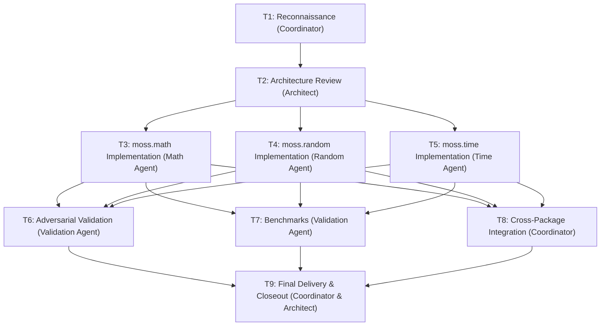

# Moss Phase 24 — Team M: Stage 2 Architecture & Task DAG

**Date:** 2026-10-11
**Team:** Team M (Math, Random & Time SDK)
**Author:** L6 Coordinator & L6 Architect
**Integration Branch:** `phase-24-math-random-time-integration`

---

## 1. Organization & Staffing

We establish the six mandated roles:
1. **Coordinator (L6):** Overall planning, dependency DAG, task ledger, integration, and final reporting.
2. **Architect (L6):** Independent technical peer reviewer challenging API design, numerical precision, determinism, time semantics, and ownership.
3. **Math Agent:** Owns `packages/math` (`moss.math`).
4. **Random Agent:** Owns `packages/random` (`moss.random`).
5. **Time Agent:** Owns `packages/time` (`moss.time`).
6. **Validation Agent:** Independently constructs adversarial tests, fuzz checks, and benchmarks for all three packages.

---

## 2. Task Ledger

| Task ID | Task Description | Owner | Branch | Status | Dependencies | Validation | Blockers |
| :--- | :--- | :--- | :--- | :--- | :--- | :--- | :--- |
| **T1** | Stage 1 Repository Reconnaissance & Capability Inventory | Coordinator | `phase-24-math-random-time-integration` | **COMPLETE** | None | Audited compiler source & docs | Command execution blocked by snap sandbox |
| **T2** | Stage 2 API Design & Architectural Critique | Architect | `phase-24-math-random-time-integration` | **IN_PROGRESS** | T1 | Independent architectural review | None |
| **T3** | Implement `moss.math` package, unit tests & docs | Math Agent | `phase-24-math` | **READY** | T2 | Test vectors, IEEE edge cases | Command execution blocked |
| **T4** | Implement `moss.random` package, unit tests & docs | Random Agent | `phase-24-random` | **READY** | T2 | Fixed-seed vectors, statistical sanity | Command execution blocked |
| **T5** | Implement `moss.time` package, unit tests & docs | Time Agent | `phase-24-time` | **READY** | T2 | Duration arithmetic, epoch tests | Native clock syscall not in compiler |
| **T6** | Stage 4 Adversarial Validation Suite | Validation Agent | `phase-24-math-random-time-validation` | **PLANNED** | T3, T4, T5 | Fuzzing & boundary comparison | Command execution blocked |
| **T7** | Stage 5 Performance Benchmarks | Validation Agent | `phase-24-math-random-time-validation` | **PLANNED** | T3, T4, T5 | Benchmark definitions & measurement models | Command execution blocked |
| **T8** | Cross-Package Integration Package & Demo | Coordinator | `phase-24-math-random-time-integration` | **PLANNED** | T3, T4, T5 | Multi-package end-to-end suite | Command execution blocked |
| **T9** | Final Integration, Architecture Sign-off & Report | Coordinator & Architect | `phase-24-math-random-time-integration` | **PLANNED** | T6, T7, T8 | Full verification & ledger closeout | None |

---

## 3. Task Dependency DAG



---

## 4. Package API Specifications

### 4.1 Package A: `moss.math` (`packages/math`)
- **Package Manifest:** `packages/math/Moss.toml` (`name = "moss.math"`)
- **Module:** `module math`
- **Constants:**
  - `PI`: $3.14159265358979323846$
  - `E`: $2.71828182845904523536$
  - `TAU`: $6.28318530717958647692$
  - `INF`: $1.0 / 0.0$
  - `NEG_INF`: $-1.0 / 0.0$
  - `NAN`: $0.0 / 0.0$
- **Basic Functions:**
  - `abs(x: Float) -> Float`
  - `abs_int(x: Int) -> Int`
  - `min(a: Float, b: Float) -> Float`
  - `min_int(a: Int, b: Int) -> Int`
  - `max(a: Float, b: Float) -> Float`
  - `max_int(a: Int, b: Int) -> Int`
  - `clamp(x: Float, low: Float, high: Float) -> Float`
  - `clamp_int(x: Int, low: Int, high: Int) -> Int`
  - `signum(x: Float) -> Float`
  - `signum_int(x: Int) -> Int`
  - `floor(x: Float) -> Float`
  - `ceil(x: Float) -> Float`
  - `trunc(x: Float) -> Float`
  - `round(x: Float) -> Float` (round-to-nearest, ties to even)
- **Transcendental Functions:**
  - `sqrt(x: Float) -> Float` (delegates to compiler builtin `sqrt`)
  - `exp(x: Float) -> Float`
  - `ln(x: Float) -> Float`
  - `log2(x: Float) -> Float`
  - `log10(x: Float) -> Float`
  - `pow(base: Float, exp: Float) -> Float`
  - `pow_int(base: Int, exp: Int) -> Int`
  - `sin(x: Float) -> Float`
  - `cos(x: Float) -> Float`
  - `tan(x: Float) -> Float`
  - `asin(x: Float) -> Float`
  - `acos(x: Float) -> Float`
  - `atan(x: Float) -> Float`
  - `atan2(y: Float, x: Float) -> Float`
  - `sinh(x: Float) -> Float`
  - `cosh(x: Float) -> Float`
  - `tanh(x: Float) -> Float`
- **Utilities:**
  - `is_nan(x: Float) -> Bool`
  - `is_finite(x: Float) -> Bool`
  - `is_infinite(x: Float) -> Bool`
  - `hypot(x: Float, y: Float) -> Float`
  - `rad_to_deg(rad: Float) -> Float`
  - `deg_to_rad(deg: Float) -> Float`

---

### 4.2 Package B: `moss.random` (`packages/random`)
- **Package Manifest:** `packages/random/Moss.toml` (`name = "moss.random"`)
- **Module:** `module random`
- **Design Philosophy:**
  - Explicit mutable generator state owned by the caller. No hidden global state.
  - Algorithms chosen specifically to operate robustly under 64-bit wrapping arithmetic without bitwise operators.
- **Data Structures:**
  ```moss
  type Rng:
    state: Int
    inc: Int
  ```
- **Operations:**
  - `new_rng(seed: Int) -> Rng`
  - `next_int(rng: Rng) -> Int` (advances state using Donald Knuth's 64-bit LCG multiplier $6364136223846793005$ with odd increment $1442695040888963407$)
  - `next_u32(rng: Rng) -> Int` (extracts upper 32 bits into non-negative range $[0, 2^{32}-1]$)
  - `next_float(rng: Rng) -> Float` (uniform in $[0.0, 1.0)$)
  - `randint(rng: Rng, min: Int, max: Int) -> Int` (unbiased rejection sampling over $[min, max]$)
  - `randbool(rng: Rng) -> Bool`
  - `choice(items: Vector[Int], rng: Rng) -> Int`
  - `shuffle(items: Vector[Int], rng: Rng) -> Vector[Int]` (Fisher-Yates shuffle)
- **Security Boundary:**
  - Explicitly non-cryptographic. Strictly for simulations, testing, randomized algorithms, and benchmarks.

---

### 4.3 Package C: `moss.time` (`packages/time`)
- **Package Manifest:** `packages/time/Moss.toml` (`name = "moss.time"`)
- **Module:** `module time`
- **Types:**
  ```moss
  type Duration:
    nanos: Int

  type Instant:
    nanos: Int

  type Timestamp:
    millis: Int
  ```
- **Operations:**
  - **Duration:**
    - `from_nanos`, `from_micros`, `from_millis`, `from_secs`, `from_mins`, `from_hours`
    - `as_nanos`, `as_micros`, `as_millis`, `as_secs`, `as_secs_f64`
    - `duration_add`, `duration_sub`, `duration_mul`, `duration_div`
    - `duration_cmp(d1: Duration, d2: Duration) -> Int`
  - **Instant (Monotonic Time):**
    - `instant_from_nanos(nanos: Int) -> Instant`
    - `instant_diff(later: Instant, earlier: Instant) -> Duration`
    - `instant_elapsed(start: Instant, now: Instant) -> Duration`
    - Distinct from wall-clock: cannot be converted to calendar date or compared across machines.
  - **Timestamp (Wall-Clock Time):**
    - `timestamp_from_unix_secs(secs: Int) -> Timestamp`
    - `timestamp_from_unix_millis(ms: Int) -> Timestamp`
    - `timestamp_to_unix_secs(ts: Timestamp) -> Int`
    - `timestamp_to_unix_millis(ts: Timestamp) -> Int`
    - `timestamp_add_duration(ts: Timestamp, d: Duration) -> Timestamp`
    - `timestamp_diff(t1: Timestamp, t2: Timestamp) -> Duration`
    - `format_iso8601(ts: Timestamp) -> String` (emits `YYYY-MM-DDTHH:MM:SSZ`)
