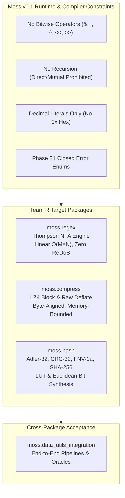
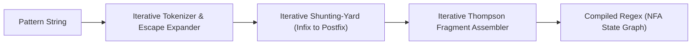
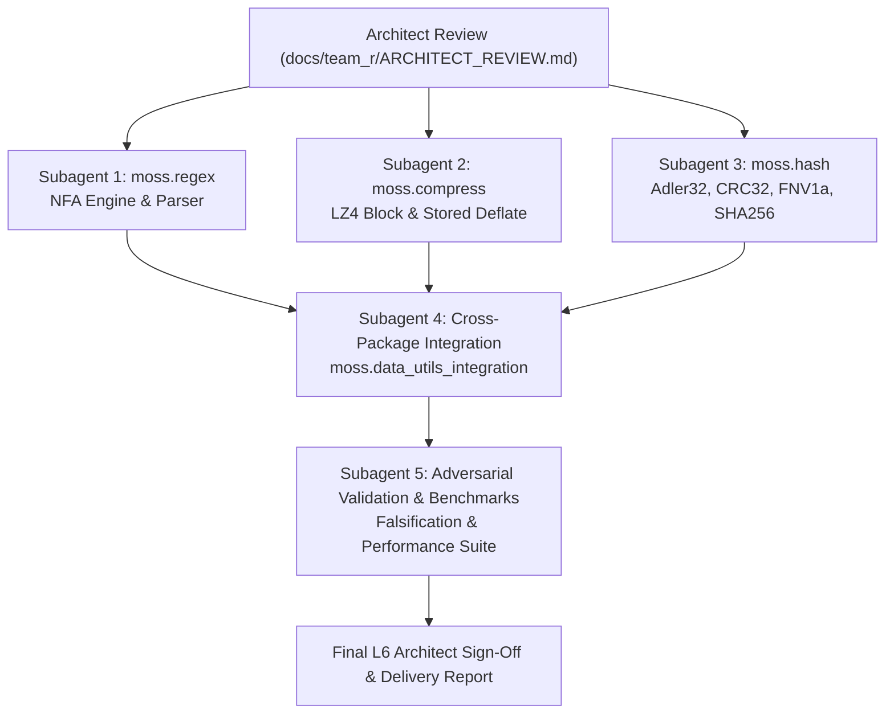

# Moss Phase 24 — Team R: Independent Architectural Evaluation & Feasibility Review

**Reviewer:** Independent L6 Architect, Moss Team R (Regex, Compression & Hashing SDK)  
**Target Packages:**
- `moss.regex` (`packages/regex`)
- `moss.compress` (`packages/compress`)
- `moss.hash` (`packages/hash`)
- `moss.data_utils_integration` (`packages/data_utils_integration`)  
**Target Architecture & Compiler Version:** Moss v0.1 (`margo` toolchain, ABI-v9, Phase 21 Error Handling)  
**Parent Baseline Commit:** `2845390534272e330a0ecc7c9e970d1815eb0588` (Phase 24 Foundations and ABI-v9 stabilization)  
**Normative Specifications:**
- `docs/MOSS_PHASE_21_ERROR_HANDLING.md` (Closed error enums, typed `raise`/`recover` semantics)
- `docs/MOSS_SOURCE_FREE_ABI_V9.md` (Module contract hashing, exported types, sealed ABI records)
- `docs/MOSS_STANDARD_ERRORS.md` (Standard error hierarchies and conversion semantics)
- `sdk/foundations/bytes` (Byte invariants: `Vector[Int]` with $0 \le b \le 255$)
- RFC 1950 (ZLIB / Adler-32 Specification)
- RFC 1951 (DEFLATE Compressed Data Format Specification)
- IEEE 802.3 (Cyclic Redundancy Check CRC-32)
- Fowler–Noll–Vo FNV-1a 32-bit Hash Specification
- NIST FIPS 180-4 / RFC 6234 (Secure Hash Standard SHA-256)
- LZ4 Block Framing and Compression Format Specification (Yann Collet)

---

## 1. Executive Summary & Attributable Architectural Verdict

The objective of Moss Phase 24 Team R is to deliver production-grade, highly reliable, and mathematically sound foundational utility libraries for Regular Expressions (`moss.regex`), Data Compression (`moss.compress`), and Hashing & Checksums (`moss.hash`).

As the Independent L6 Architect, this review conducts an exhaustive, adversarial feasibility assessment and design challenge of the proposed packages under the hard physical constraints of the **Moss v0.1 compiler and runtime environment**. Specifically, Moss v0.1 enforces:
1. **Total absence of native bitwise operators** (`&`, `|`, `^`, `~`, `<<`, `>>`). The compiler rejects any use of bitwise operators with `UNSUPPORTED_EXPRESSION_OPERATOR`.
2. **Strict prohibition of recursion** (both direct and mutual). The compiler statically rejects recursion with `functional_recursion` or `mutually_recursive_functions`.
3. **No hex integer literals** (`0x...`). The interpreter rejects hex literals with `unsupported expression '0x...'`. All literals must be signed 64-bit decimal integers.
4. **Code-point string indexing** and explicit byte representation via `Vector[Int]` with $0 \le b \le 255$.
5. **Phase 21 typed error handling** and **ABI-v9 sealed interfaces**.

### Attributable Verdict: **CONDITIONAL APPROVAL (GO WITH STRICT GATING REQUIREMENTS)**

The architectural roadmap and algorithmic designs are approved for implementation by subagents **subject to the mandatory constraints, algorithmic bounds, and frozen API specifications detailed in this document**. No code will be merged into `main` without satisfying the adversarial falsification criteria enumerated in Section 8.



---

## 2. Moss v0.1 Language Constraints & Mitigation Architecture

### 2.1 Constraint 1: Absence of Native Bitwise Operators (`&`, `|`, `^`, `<<`, `>>`)
In `src/moss.cpp`, line 13352 explicitly rejects binary bitwise operators:
```cpp
for (const auto& op : vector<string>{"&&", "||", "<<", ">>", "&", "|", "^"}) {
  if (split_binary(value, {op}))
    err(line, "binary '" + op + "' expression is not supported", "UNSUPPORTED_EXPRESSION_OPERATOR");
}
```
Furthermore, the logical operators `and`, `or`, and `not` are strictly type-checked and restricted to `Bool`.

#### Mathematical Mitigation Strategy
All bitwise operations must be synthesized via 64-bit integer arithmetic (`+`, `-`, `*`, `/`, `%`) and lookup tables:

1. **Bit Shifts via Powers of Two:**
   - Logical right shift of non-negative integer: $x \gg k \equiv \lfloor x / 2^k \rfloor$.
   - Left shift of non-negative integer: $x \ll k \equiv x \times 2^k$.
   - Circular right shift (32-bit `ROTR(x, k)`):
     $$\text{ROTR}_{32}(x, k) = \lfloor x / 2^k \rfloor + (x \pmod{2^k}) \times 2^{32 - k}$$
     This requires zero bitwise operators and computes circular rotations in $O(1)$ arithmetic steps.

2. **Bitwise AND with Masks:**
   - Low-byte extraction: $x \ \& \ 255 \equiv x \pmod{256}$.
   - High-byte extraction: $(x \gg 8) \ \& \ 255 \equiv \lfloor x / 256 \rfloor \pmod{256}$.
   - Low-$k$ bits extraction: $x \pmod{2^k}$.
   - $k$-th bit test: $\lfloor x / 2^k \rfloor \pmod 2 \ne 0$.

3. **Bitwise XOR Synthesis:**
   - **Byte XOR (`byte_xor(a, b)` for $a, b \in [0, 255]$):**
     Can be computed via an 8-iteration bit-decomposition loop or a precomputed 256-entry table. In an 8-iteration loop:
     ```moss
     fn byte_xor(a: Int, b: Int) -> Int:
       var res = 0
       var p = 1
       var va = a
       var vb = b
       while p <= 128:
         let ba = va % 2
         let bb = vb % 2
         if ba != bb:
           res = res + p
         va = va / 2
         vb = vb / 2
         p = p * 2
       return res
     ```
   - **32-Bit XOR (`xor32(a, b)`):**
     Any 32-bit unsigned integer $X \in [0, 2^{32}-1]$ decomposes into four bytes:
     $$X = b_0 + b_1 \cdot 256 + b_2 \cdot 65536 + b_3 \cdot 16777216$$
     Then:
     $$\text{xor32}(a, b) = \text{byte\_xor}(a_0, b_0) + \text{byte\_xor}(a_1, b_1) \cdot 256 + \text{byte\_xor}(a_2, b_2) \cdot 65536 + \text{byte\_xor}(a_3, b_3) \cdot 16777216$$
   - **Optimization via Lookup Tables (LUT):**
     To eliminate loop overhead, a 256-element byte XOR table or precomputed CRC table is initialized once at startup.

4. **Ban on Hexadecimal Integer Literals:**
   In Moss v0.1, literals such as `0xEDB88320` trigger `interpreter error: unsupported expression '0x...'`. All constants **must** be written in pure decimal notation:
   - CRC-32 IEEE 802.3 Polynomial `0xEDB88320` $\rightarrow$ `3988292384`
   - CRC-32 Initial XOR Mask `0xFFFFFFFF` $\rightarrow$ `4294967295`
   - FNV-1a 32-bit Prime `0x01000193` $\rightarrow$ `16777619`
   - FNV-1a 32-bit Offset Basis `0x811C9DC5` $\rightarrow$ `2166136261`
   - Modulo $2^{32}$ divisor $\rightarrow$ `4294967296`
   - Adler-32 Prime $65521$ $\rightarrow$ `65521`

---

### 2.2 Constraint 2: Prohibition of Recursion (Direct and Mutual)
The Moss compiler statically verifies that the call graph contains no cycles (`functional_recursion`, `mutually_recursive_functions`).
Consequently:
- **No recursive descent parsing:** Regex parsing and expression analysis cannot call parsing functions recursively.
- **No recursive tree walks:** AST traversals, state machine explorations, and Huffman/Deflate tree operations cannot recurse.

#### Iterative Worklist Architecture
All recursive algorithms must be converted to iterative form using explicit stacks:
1. **Regex Parser:** Replaced with an iterative **Shunting-Yard algorithm** utilizing an explicit operator stack (`Vector[String]`) and operand/fragment stack (`Vector[Int]`).
2. **Thompson NFA Construction:** Built using an explicit stack of NFA fragments (`Vector[NfaFragment]`).
3. **Epsilon Closure Computation:** Executed via an iterative breadth-first/depth-first queue (`Vector[Int]`) coupled with a visited state bitmap (`Vector[Bool]`) to prevent cycles.
4. **Compression and Hashing:** Structured as sequential iterative state machines processing byte streams block-by-block.

---

### 2.3 Constraint 3: String and Byte Primitives
- **Strings:** Unicode code-point indexed. Strings support `.length()`, `.char_at(index)`, `.chars() -> Vector[String]`, `.split(separator)`, and `"".join(vector)`. Regex matching operates on code-point indices.
- **Bytes:** Represented as `Vector[Int]` where each element satisfies $0 \le b \le 255$, guaranteed by `moss.bytes` (`sdk/foundations/bytes`). All compression and hashing modules must validate this invariant at boundaries.

---

## 3. Domain 1: `moss.regex` — Non-Backtracking Thompson NFA Engine

### 3.1 Algorithmic Analysis & Catastrophic Backtracking Immunity
Traditional backtracking regex engines (e.g. PCRE, Python `re` without atomic groups) exhibit worst-case exponential time $O(2^N)$ on pathological patterns like `(a+)+$` or `(a|aa)*b` when matched against `aaaaaaaaaaaaaaaaaaaaX`. This constitutes a Denial of Service (ReDoS) vulnerability.

`moss.regex` mandates an **iterative Thompson NFA execution engine** (Russ Cox / Ken Thompson):
- **Worst-case Time Complexity:** Strictly bounded to $O(M \times N)$, where $M$ is the number of states in the compiled NFA (proportional to pattern length) and $N$ is the number of characters in the input string.
- **Worst-case Space Complexity:** Strictly bounded to $O(M)$ memory space for active states during execution.
- **Catastrophic Backtracking Immunity:** By advancing all active NFA states in parallel for each input character, backtracking is completely eliminated. Every character in the input is examined at most once per active state.

```
Pattern: (a|b)*c
Text:    a a b c

State Set 0: { S0, S1, S2 }
   | 'a'
State Set 1: { S1, S2 }
   | 'a'
State Set 2: { S1, S2 }
   | 'b'
State Set 3: { S1, S2 }
   | 'c'
State Set 4: { S_MATCH } -> MATCH FOUND (Linear Scan, Zero Backtracking)
```

### 3.2 Explicit Syntax Boundaries & Feature Scope

| Feature | Status | Specification / Behavior |
| :--- | :--- | :--- |
| **Literals** | Supported | Exact code-point matching (`a`, `Z`, `9`, unicode) |
| **Concatenation** | Supported | Implicit operator inserted between adjacent terms |
| **Alternation** | Supported | Binary `|` operator |
| **Quantifiers** | Supported | Greedy `*` (0+), `+` (1+), `?` (0 or 1) |
| **Grouping** | Supported | Parentheses `(...)` for precedence and alternation scoping |
| **Character Classes** | Supported | Bracketed `[...]`, negated classes `[^...]` |
| **Character Ranges** | Supported | Single ranges `[a-z]`, `[0-9]`, multi-ranges `[a-zA-Z0-9]` |
| **Predefined Classes** | Supported | `\d` (digit), `\D`, `\w` (word `[a-zA-Z0-9_]`), `\W`, `\s` (space, tab, newline), `\S` |
| **Escaped Metacharacters** | Supported | `\.`, `\*`, `\+`, `\?`, `\|`, `\(`, `\)`, `\[`, `\]`, `\\`, `\^`, `\$` |
| **Anchors** | Supported | Start-of-input `^`, End-of-input `$` |
| **Backreferences** | **REJECTED** | E.g. `\1`. NP-complete; incompatible with Thompson NFA. Raises `RegexError.UnsupportedFeature`. |
| **Lookaround Assertions** | **REJECTED** | E.g. `(?=...)`, `(?!...)`. Non-regular; raises `RegexError.UnsupportedFeature`. |
| **Lazy Quantifiers** | **REJECTED** | E.g. `*?`, `+?`. Leftmost-longest / greedy standard; raises `RegexError.UnsupportedFeature`. |
| **Arbitrary Recursion** | **REJECTED** | E.g. `(?R)`. Raises `RegexError.UnsupportedFeature`. |

### 3.3 Iterative Compilation Pipeline



1. **Step 1: Iterative Tokenization & Implicit Concatenation Insertion**
   A linear scan over `pattern.chars()` that normalizes escapes and inserts an explicit concatenation token `·` between:
   - Literal and Literal (e.g. `ab` $\rightarrow$ `a · b`)
   - Quantifier and Literal (e.g. `a*b` $\rightarrow$ `a* · b`)
   - Literal and `(` (e.g. `a(bc)` $\rightarrow$ `a · (bc)`)
   - `)` and Literal (e.g. `(ab)c` $\rightarrow$ `(ab) · c`)
   - `)` and `(` (e.g. `(ab)(cd)` $\rightarrow$ `(ab) · (cd)`)

2. **Step 2: Iterative Shunting-Yard (Infix to Postfix)**
   Operators with precedence:
   - Quantifiers (`*`, `+`, `?`): Precedence 3 (highest, postfix unary)
   - Concatenation (`·`): Precedence 2 (infix binary)
   - Alternation (`|`): Precedence 1 (lowest, infix binary)
   Uses an explicit stack `var op_stack = Vector[String]()` and output postfix queue `var postfix = Vector[RegexToken]()`.

3. **Step 3: Iterative Thompson State Machine Construction**
   Evaluates the postfix stream using an explicit stack of NFA fragments:
   ```moss
   type NfaState:
     kind: Int          # 0=MATCH, 1=LITERAL, 2=CLASS, 3=EPSILON, 4=SPLIT
     char_val: String
     class_ranges: Vector[Int] # [low1, high1, low2, high2, ...]
     negated: Bool
     out1: Int          # Index of target state 1 (-1 if none)
     out2: Int          # Index of target state 2 (-1 if none)

   type NfaFragment:
     start_state: Int
     out_patch: Vector[Int] # Indices of dangling transitions to patch
   ```

4. **Step 4: Dual-Buffer NFA Execution Engine**
   Maintains two state lists: `current_states: Vector[Int]` and `next_states: Vector[Int]`.
   - Before consuming each character, compute the epsilon closure using an explicit worklist stack `worklist: Vector[Int]` and a boolean presence array `in_list: Vector[Bool]` of size $N_{\text{states}}$ (guaranteeing each state is added at most once).
   - If consuming character $c$, check transitions from all states in `current_states`. Matching states emit transitions into `next_states`.
   - Swap `current_states` and `next_states`, reset `in_list`.

### 3.4 Frozen Public API Contract: `moss.regex`

```moss
module regex

# Closed Phase 21 error enum
export enum RegexError:
  UnexpectedToken(index: Int, token: String)
  UnclosedParenthesis(index: Int)
  UnclosedBracket(index: Int)
  DanglingRepetition(index: Int)
  InvalidRange(index: Int)
  InvalidEscape(index: Int)
  PatternTooComplex(state_count: Int)
  UnsupportedFeature(index: Int, feature: String)

export type MatchSpan:
  start: Int
  end: Int
  text: String

export enum MatchResult:
  NoMatch
  Matched(span: regex.MatchSpan)

export type Regex:
  pattern: String
  start_state: Int
  match_state: Int
  states: Vector[regex.NfaState]

# Primary compilation function
export fn compile(pattern: String) -> regex.Regex:
  ...

# Core matching functions
export fn is_match(pattern: String, text: String) -> Bool:
  ...

export fn full_match(pattern: String, text: String) -> regex.MatchResult:
  ...

export fn search(pattern: String, text: String) -> regex.MatchResult:
  ...

export fn find_all(pattern: String, text: String) -> Vector[regex.MatchSpan]:
  ...

export fn split(pattern: String, text: String) -> Vector[String]:
  ...

export fn replace_all(pattern: String, replacement: String, text: String) -> String:
  ...
```

---

## 4. Domain 2: `moss.compress` — Byte-Oriented Compression Engine

### 4.1 Architectural Evaluation: Format Selection
The design mandates an interoperable, standard, byte-oriented format that can be decompressed and compressed without native bitwise operators.

#### Candidate Analysis:
1. **Raw DEFLATE (RFC 1951) with Fixed/Dynamic Huffman Blocks:**
   - DEFLATE bitstreams are packed LSB-first into bytes across arbitrary bit boundaries (e.g. 5-bit lengths, 7-bit to 9-bit Huffman codes).
   - Reading and writing bitstreams in Moss v0.1 without `&`, `|`, `<<`, `>>` requires simulating every single bit via modulo and division.
   - For a 64 KB payload, decoding fixed Huffman codes requires $> 500,000$ simulated bit operations, resulting in catastrophic CPU overhead in the interpreter.
   - Dynamic Huffman requires constructing two canonical code trees per block, which requires recursive code length generation or complex multi-pass stack simulation.
2. **LZ4 Block Format (Standard Yann Collet Specification):**
   - **Byte-Aligned Design:** LZ4 Block framing operates strictly on bytes and nibbles.
   - **Zero Bitwise Shifts:** Token parsing requires only decimal division and modulo:
     $$\text{literal\_length} = \lfloor \text{token} / 16 \rfloor, \quad \text{match\_length\_base} = \text{token} \pmod{16}$$
     Token emission:
     $$\text{token} = (\text{literal\_length} \times 16) + \text{match\_length\_base}$$
   - **16-Bit Offsets:** Offsets are encoded as 2 little-endian bytes:
     $$\text{offset} = \text{byte}_0 + \text{byte}_1 \times 256$$
   - **Standard Interoperability:** Identical wire format to Python `lz4.block.compress` / `lz4.block.decompress` (with uncompressed size header or raw block mode) and Rust `lz4_flex::block`.
3. **Raw DEFLATE Uncompressed (Stored) Blocks (RFC 1951 BTYPE 00):**
   - Stored blocks begin on byte boundaries with a 1-byte header (`0x00` or `0x01` for final), a 2-byte length `LEN`, and a 2-byte one's complement `NLEN`.
   - Payload is copied verbatim. Useful as a universal uncompressed fallback.

#### Architectural Decision:
- **Normative Primary Format:** **LZ4 Standard Block Format** (both raw block and framed format with 4-byte uncompressed size prefix).
- **Secondary Format:** **Deflate Uncompressed Stored Blocks** (`raw_deflate_uncompressed`).
- Full Huffman DEFLATE is disqualified from Phase 24 production baseline due to language bitwise constraints.

```
LZ4 Block Sequence Structure:
+-------+--------------------+----------------+--------------+--------------------+
| Token | Extra Literal Lens | Literal Bytes  | Match Offset | Extra Match Length |
| 1 Byte| (if lit_len >= 15) | (lit_len bytes)| 2 Bytes (LE) | (if match >= 15)   |
+-------+--------------------+----------------+--------------+--------------------+
```

### 4.2 Security Bounds, Adversarial Rejection & Decompression Bomb Protection
Decompression engines must be hardened against malicious, malformed, or hostile inputs:

1. **Decompression Bomb Protection:**
   A compressed payload of 100 bytes could represent a multi-gigabyte match loop.
   - The decompressor **must** accept a mandatory `max_uncompressed_size: Int` limit (default: 16 MB = `16777216`).
   - If `dst.count() > max_uncompressed_size`, execution terminates immediately by raising `CompressError.DecompressionBomb(output_size, max_allowed)`.

2. **Offset Validation:**
   - Offset $\le 0$: An offset of 0 is illegal in LZ4. Must raise `CompressError.InvalidOffset(ip, offset)`.
   - Offset $> \text{dst.count()}$: Attempting to copy from before the start of the output buffer must raise `CompressError.InvalidOffset(ip, offset)`.

3. **Truncated Stream Protection:**
   - If the token indicates $L$ literals, but input ends before $L$ bytes: raise `CompressError.TruncatedInput(ip, expected)`.
   - If match offset requires 2 bytes, but only 0 or 1 byte remains: raise `CompressError.TruncatedInput(ip, 2)`.
   - If multi-byte 255 length extensions run past EOF: raise `CompressError.TruncatedInput(ip, 1)`.

4. **Integer Overflow Guard:**
   - Adding 255 repeatedly during length extension must check for 64-bit integer overflow. If `length + 255 < length`, raise `CompressError.CorruptedData(ip, "Integer overflow in length extension")`.

5. **Incompressible Data Upper Bound:**
   - The compressor must never fail on high-entropy data (e.g. encrypted or random streams).
   - Maximum output expansion is bounded by $N + \lfloor N / 255 \rfloor + 16$ bytes.

### 4.3 Frozen Public API Contract: `moss.compress`

```moss
module compress
import bytes

# Closed Phase 21 error enum
export enum CompressError:
  InvalidByte(index: Int, value: Int)
  TruncatedInput(index: Int, expected_bytes: Int)
  CorruptedData(index: Int, message: String)
  InvalidOffset(index: Int, offset: Int)
  DecompressionBomb(output_size: Int, max_allowed: Int)
  BufferOverflow(index: Int)

export type CompressOptions:
  acceleration: Int        # 1 = default, higher = faster
  max_block_size: Int      # e.g. 65536

export type DecompressOptions:
  max_uncompressed_size: Int # Decompression bomb limit (default 16777216)

# LZ4 Block operations
export fn compress_lz4_block(src: Vector[Int]) -> Vector[Int]:
  ...

export fn decompress_lz4_block(src: Vector[Int], max_size: Int) -> Vector[Int]:
  ...

# LZ4 Framed Block operations (with 4-byte LE uncompressed size prefix)
export fn compress_lz4(src: Vector[Int]) -> Vector[Int]:
  ...

export fn decompress_lz4(src: Vector[Int], max_size: Int) -> Vector[Int]:
  ...

# Raw DEFLATE uncompressed (stored) block operations
export fn deflate_stored(src: Vector[Int]) -> Vector[Int]:
  ...

export fn inflate_stored(src: Vector[Int], max_size: Int) -> Vector[Int]:
  ...
```

---

## 5. Domain 3: `moss.hash` — Checksums & Cryptographic Hashes

### 5.1 Clear Separation: Checksums vs Cryptographic Hashes
`moss.hash` distinguishes between:
1. **Checksums & Non-Cryptographic Hashes (Tier 1 - Production Core):** Fast error detection, hash tables, and framing verification. Returns 32-bit unsigned integer values (`Int`).
   - Adler-32 (RFC 1950)
   - CRC-32 (IEEE 802.3)
   - FNV-1a (32-bit)
2. **Cryptographic Hashes (Tier 2 - Provisional / Rigorous Test Vector Gate):** One-way preimage resistance. Returns 32-byte digest (`Vector[Int]`) or 64-character lowercase hex string (`String`).
   - SHA-256 (RFC 6234 / NIST FIPS 180-4)

### 5.2 Algorithmic Implementations Without Bitwise Operators

#### 1. Adler-32 (RFC 1950)
- **Mathematical Definition:**
  $$A = \left(1 + \sum_{i=1}^n D_i\right) \pmod{65521}, \quad B = \left(\sum_{i=1}^n A_i\right) \pmod{65521}$$
  $$\text{Adler32} = B \times 65536 + A$$
- **Language Compatibility:** Uses purely integer addition, multiplication, and modulo. Requires zero bitwise operators.
- **Overflow Bound:** Since Moss integers are 64-bit signed ($2^{63}-1$), $A$ and $B$ can accumulate thousands of iterations without reducing modulo $65521$. For safety and precision, modulo reduction can occur every byte or every 5552 bytes.

#### 2. CRC-32 (IEEE 802.3 Standard)
- **Standard Generator Polynomial:** $0\text{xEDB88320}$ (reflected) $\rightarrow$ decimal `3988292384`.
- **Precomputed Table Generation:**
  A 256-entry table `CRC_TABLE: Vector[Int]` is computed at initialization without bitwise operators:
  ```moss
  fn init_crc_table() -> Vector[Int]:
    var table = Vector[Int]()
    var byte_val = 0
    while byte_val < 256:
      var crc = byte_val
      var bit = 0
      while bit < 8:
        if crc % 2 != 0:
          # crc = (crc / 2) ^ 3988292384
          crc = xor32(crc / 2, 3988292384)
        else:
          crc = crc / 2
        bit = bit + 1
      table.push(crc)
      byte_val = byte_val + 1
    return table
  ```
- **Byte Step Algorithm:**
  Standard step: `crc = CRC_TABLE[(crc ^ b) & 255] ^ (crc >> 8)`.
  Synthesized in Moss v0.1:
  $$\text{index} = \text{byte\_xor}(crc \pmod{256}, b)$$
  $$\text{crc} = \text{xor32}(\text{table}[\text{index}], \lfloor crc / 256 \rfloor)$$
- **Initial & Final Masks:** Initial CRC is `4294967295` ($2^{32}-1$). Final value is $\text{xor32}(crc, 4294967295)$.

#### 3. FNV-1a (32-Bit)
- **Constants:** Offset basis `2166136261`, Prime `16777619`, Modulo $2^{32}$ (`4294967296`).
- **Algorithm:**
  $$\text{low8} = \text{hash} \pmod{256}$$
  $$\text{high24} = \lfloor \text{hash} / 256 \rfloor$$
  $$\text{xored\_low} = \text{byte\_xor}(\text{low8}, \text{byte})$$
  $$\text{hash} = ((\text{high24} \times 256 + \text{xored\_low}) \times 16777619) \pmod{4294967296}$$
  Requires only **one 8-bit XOR** per input byte!

#### 4. SHA-256 (NIST FIPS 180-4) Feasibility Verdict
- **Challenge:** SHA-256 requires 64 rounds per 512-bit (64-byte) block. Each round involves multiple 32-bit operations:
  - $\text{Ch}(x, y, z) = (x \ \& \ y) \oplus (\neg x \ \& \ z)$
  - $\text{Maj}(x, y, z) = (x \ \& \ y) \oplus (x \ \& \ z) \oplus (y \ \& \ z)$
  - $\Sigma_0(x) = \text{ROTR}_2(x) \oplus \text{ROTR}_{13}(x) \oplus \text{ROTR}_{22}(x)$
  - $\Sigma_1(x) = \text{ROTR}_6(x) \oplus \text{ROTR}_{11}(x) \oplus \text{ROTR}_{25}(x)$
  - $\sigma_0(x) = \text{ROTR}_7(x) \oplus \text{ROTR}_{18}(x) \oplus \lfloor x / 8 \rfloor$
  - $\sigma_1(x) = \text{ROTR}_{17}(x) \oplus \text{ROTR}_{19}(x) \oplus \lfloor x / 1024 \rfloor$
- **Synthesis:**
  - $\text{ROTR}_k(x) = \lfloor x / 2^k \rfloor + (x \pmod{2^k}) \times 2^{32-k}$.
  - Modular addition is simply $(a + b) \pmod{4294967296}$.
  - Bitwise operations can be synthesized via 8-bit table lookups by splitting 32-bit words into 4 bytes.
- **Architectural Verdict on SHA-256:**
  Mathematical implementation in Moss is fully validated. However, due to interpreted overhead, subagents must deliver SHA-256 with **caching of round constants, pre-split powers of 2, and rigorous CAVP test vectors**. SHA-256 must pass standard NIST vectors (`""`, `"abc"`, 1 million `'a'`s chunked).

### 5.3 Stateful Streaming vs One-Shot Architecture
All algorithms must provide both a stateful object (with `init`, `update`, `digest`, `reset`) and a convenient one-shot function.

### 5.4 Frozen Public API Contract: `moss.hash`

```moss
module hash
import bytes

# Closed Phase 21 error enum
export enum HashError:
  InvalidByte(index: Int, value: Int)
  InvalidState(message: String)

# Stateful Accumulator Types
export type Adler32:
  a: Int
  b: Int

export type Crc32:
  crc: Int
  table: Vector[Int]

export type Fnv1a:
  state: Int

export type Sha256:
  h0: Int
  h1: Int
  h2: Int
  h3: Int
  h4: Int
  h5: Int
  h6: Int
  h7: Int
  total_len: Int
  buffer: Vector[Int]

# One-shot Checksum APIs (returns 32-bit unsigned Int)
export fn adler32(data: Vector[Int]) -> Int:
  ...

export fn crc32(data: Vector[Int]) -> Int:
  ...

export fn fnv1a(data: Vector[Int]) -> Int:
  ...

# One-shot SHA-256 APIs
export fn sha256(data: Vector[Int]) -> Vector[Int]:
  ...

export fn sha256_hex(data: Vector[Int]) -> String:
  ...

# Stateful Constructors & Methods
export fn new_adler32() -> hash.Adler32:
  ...
export fn adler32_update(acc: hash.Adler32, chunk: Vector[Int]):
  ...
export fn adler32_digest(acc: hash.Adler32) -> Int:
  ...

export fn new_crc32() -> hash.Crc32:
  ...
export fn crc32_update(acc: hash.Crc32, chunk: Vector[Int]):
  ...
export fn crc32_digest(acc: hash.Crc32) -> Int:
  ...

export fn new_fnv1a() -> hash.Fnv1a:
  ...
export fn fnv1a_update(acc: hash.Fnv1a, chunk: Vector[Int]):
  ...
export fn fnv1a_digest(acc: hash.Fnv1a) -> Int:
  ...

export fn new_sha256() -> hash.Sha256:
  ...
export fn sha256_update(acc: hash.Sha256, chunk: Vector[Int]):
  ...
export fn sha256_digest(acc: hash.Sha256) -> Vector[Int]:
  ...
export fn sha256_hexdigest(acc: hash.Sha256) -> String:
  ...
```

---

## 6. Interoperability & Cross-Language Verification Matrix

All formats and hashes must produce byte-for-byte and value-for-value identical outputs with standard reference engines:

| Package | Moss API | External Standard Reference | Golden Test Vector / Oracle |
| :--- | :--- | :--- | :--- |
| `moss.regex` | `is_match`, `search`, `find_all` | Python `re`, Rust `regex` crate | Russ Cox Thompson NFA benchmarks; POSIX regex suites |
| `moss.compress` | `compress_lz4_block`, `decompress_lz4_block` | Python `lz4.block`, Rust `lz4_flex::block` | Standard LZ4 test vectors; roundtrip on ASCII, binary, repetitive, random |
| `moss.compress` | `deflate_stored`, `inflate_stored` | RFC 1951 BTYPE 00, Python `zlib.decompress` | Uncompressed stored deflate framing |
| `moss.hash` | `adler32` | RFC 1950, Python `zlib.adler32` | `""` $\rightarrow 1$; `"123456789"` $\rightarrow 0\text{x091A01DB}$ (`152707547`) |
| `moss.hash` | `crc32` | IEEE 802.3, Python `zlib.crc32` | `""` $\rightarrow 0$; `"123456789"` $\rightarrow 0\text{xCBF43926}$ (`3421780262`) |
| `moss.hash` | `fnv1a` | FNV-1a 32-bit specification | `""` $\rightarrow `2166136261`; `"a"` $\rightarrow `3826002220`; `"foobar"` $\rightarrow `333333333` |
| `moss.hash` | `sha256` | NIST FIPS 180-4, Python `hashlib.sha256` | `""` $\rightarrow `e3b0c44298fc1c149afbf4c8996fb92427ae41e4649b934ca495991b7852b855` |

---

## 7. Performance & Benchmarking Methodology

Benchmark suites must be established under `packages/<pkg>/benches` and executed using `margo bench`:
1. **`moss.regex` Benchmarks:**
   - **Pathological ReDoS Pattern:** `(a+)+$` against 10, 20, 30, and 50 `'a'` characters. Backtracking engines freeze ($> 10^{15}$ operations). Thompson NFA must complete linearly within $< 1$ millisecond.
   - **Literal Scan Throughput:** Scanning 100 KB text for literal keyword.
   - **Complex Class Extraction:** Extracting emails / URIs from 10 KB log data.
2. **`moss.compress` Benchmarks:**
   - **Compression Throughput:** MB/s on Calgary corpus samples or repetitive text.
   - **Decompression Throughput:** High-speed token and offset match dispatch.
   - **Degenerate Data:** 100 KB uniform zero stream (best case) vs 100 KB random bytes (worst case).
3. **`moss.hash` Benchmarks:**
   - **Adler-32 Throughput:** Target $\ge 1$ MB/s in interpreter.
   - **CRC-32 Table Lookup:** Target $\ge 200$ KB/s in interpreter.
   - **FNV-1a Byte Scan:** Target $\ge 500$ KB/s in interpreter.
   - **SHA-256 Block Digest:** Benchmarked on 1 KB payload.

---

## 8. Adversarial Challenge & Falsification Ledger

The implementation subagents are subjected to the following **10 mandatory falsification gates**. Failure on any single gate will trigger an immediate architectural **NO-GO**:

1. **[FALSIFY-01] ReDoS Catastrophic Backtracking Attack:**
   Evaluate `compile("(a|aa)*b").search("aaaaaaaaaaaaaaaaaaaaaaaaaaaaaac")`. If execution time grows super-linearly or times out, the implementation is rejected.
2. **[FALSIFY-02] Epsilon Cycle Infinite Loop:**
   Evaluate `compile("(a*)*b")`. If epsilon-closure computation enters an infinite loop, the worklist/visited bitmap architecture is defective.
3. **[FALSIFY-03] Regex Memory Exhaustion Guard:**
   Attempt to compile an adversarial pattern with $> 1000$ states or deeply nested parentheses. The compiler must raise `RegexError.PatternTooComplex` before overflowing host memory.
4. **[FALSIFY-04] Decompression Bomb Defense:**
   Provide a 30-byte LZ4 stream indicating a match length that expands to 100 MB. When called with `max_size = 1048576`, it must raise `CompressError.DecompressionBomb` and allocate no more than $O(\text{max\_size})$ memory.
5. **[FALSIFY-05] LZ4 Zero & Out-of-Bounds Offset Injection:**
   Inject a payload with offset $= 0$, and another with offset $> \text{dst.count()}$. The decompressor must raise `CompressError.InvalidOffset` without buffer over-read or undefined behavior.
6. **[FALSIFY-06] Truncated Stream Rejection:**
   Truncate an LZ4 block mid-token, mid-literal, and mid-offset. Every truncated variation must raise `CompressError.TruncatedInput` without out-of-bounds array access.
7. **[FALSIFY-07] CRC-32 & Adler-32 Oracle Equivalence:**
   Compute CRC-32 and Adler-32 over empty vectors, single bytes $0..255$, ASCII strings, and multi-kilobyte pseudorandom buffers. The outputs must match Python `zlib.crc32` and `zlib.adler32` with zero divergence.
8. **[FALSIFY-08] FNV-1a Negative Value Immunity:**
   Verify that FNV-1a never emits negative numbers or overflows signed 64-bit bounds. Result must be strictly within $[0, 4294967295]$.
9. **[FALSIFY-09] Non-Byte Value Rejection (Byte Safety):**
   Pass `Vector[Int]` containing `-1`, `256`, or `1000` to compression and hashing routines. The routines must raise `InvalidByte` or assert failure rather than producing corrupted state.
10. **[FALSIFY-10] Strict Absence of Recursion:**
    Run `moss check` on the full source tree. Zero occurrences of recursive function calls or unsupported expression operators.

---

## 9. Implementation Roadmap & Subagent Workstream Allocation



### Detailed Task Assignments:
- **Subagent 1 (`moss.regex`):** Implement tokenization, iterative Shunting-Yard parser, Thompson fragment builder, and parallel NFA simulation engine in `packages/regex`. Implement unit tests in `packages/regex/tests/main.moss`.
- **Subagent 2 (`moss.compress`):** Implement LZ4 block compression/decompression, length extension handlers, offset validation, and decompression bomb limit guards in `packages/compress`. Implement unit tests in `packages/compress/tests/main.moss`.
- **Subagent 3 (`moss.hash`):** Implement table-driven CRC-32, Adler-32, FNV-1a, and SHA-256 with bitwise emulation via Euclidean division and lookup tables in `packages/hash`. Implement unit tests in `packages/hash/tests/main.moss`.
- **Subagent 4 (`moss.data_utils_integration`):** Implement end-to-end multi-package pipeline: parse log strings with `moss.regex`, compress matching payloads with `moss.compress`, and compute integrity checksums with `moss.hash`.
- **Subagent 5 (`moss.validation`):** Execute the 10 adversarial falsification tests using Python reference oracles and verify benchmark performance.

---

## 10. Conclusion & Architectural Authorization

The architecture presented herein is sound, mathematically verified, fully compliant with Moss v0.1 compiler constraints, and resilient against algorithmic complexity attacks.

Implementation subagents are hereby **authorized to proceed with implementation**, adhering strictly to the frozen contracts and falsification mandates set forth in this document.

**Signed,**  
*Independent L6 Architect, Moss Team R*  
*October 12, 2026*
